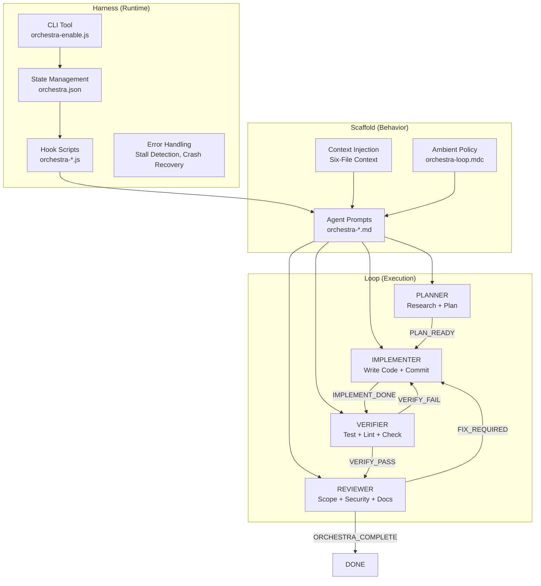
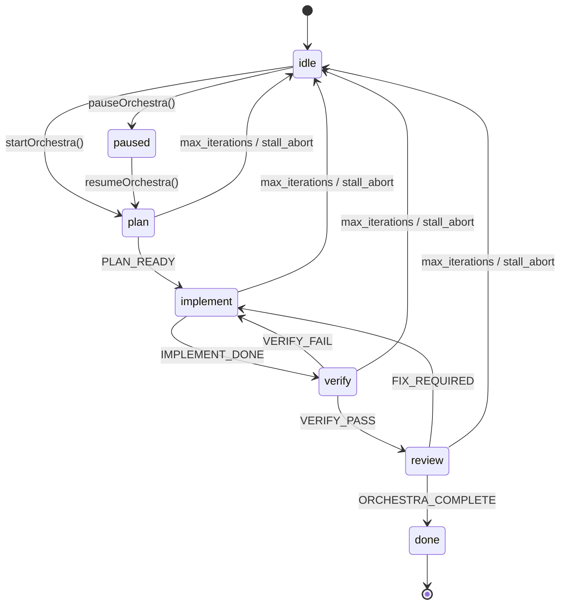
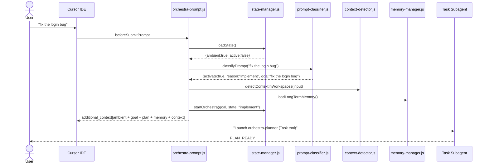
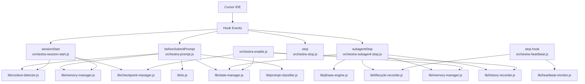
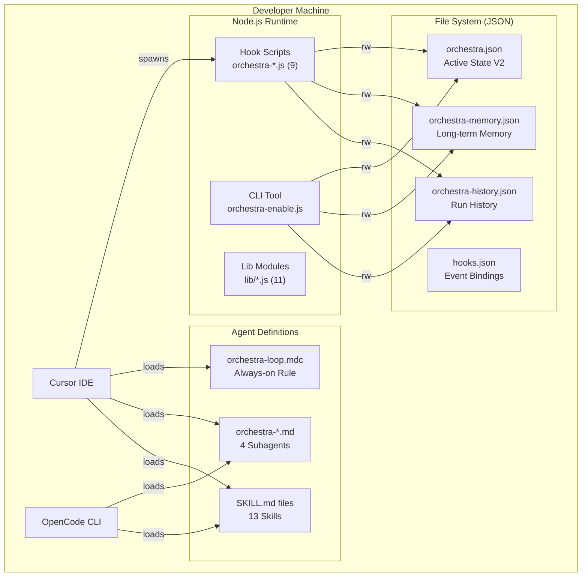
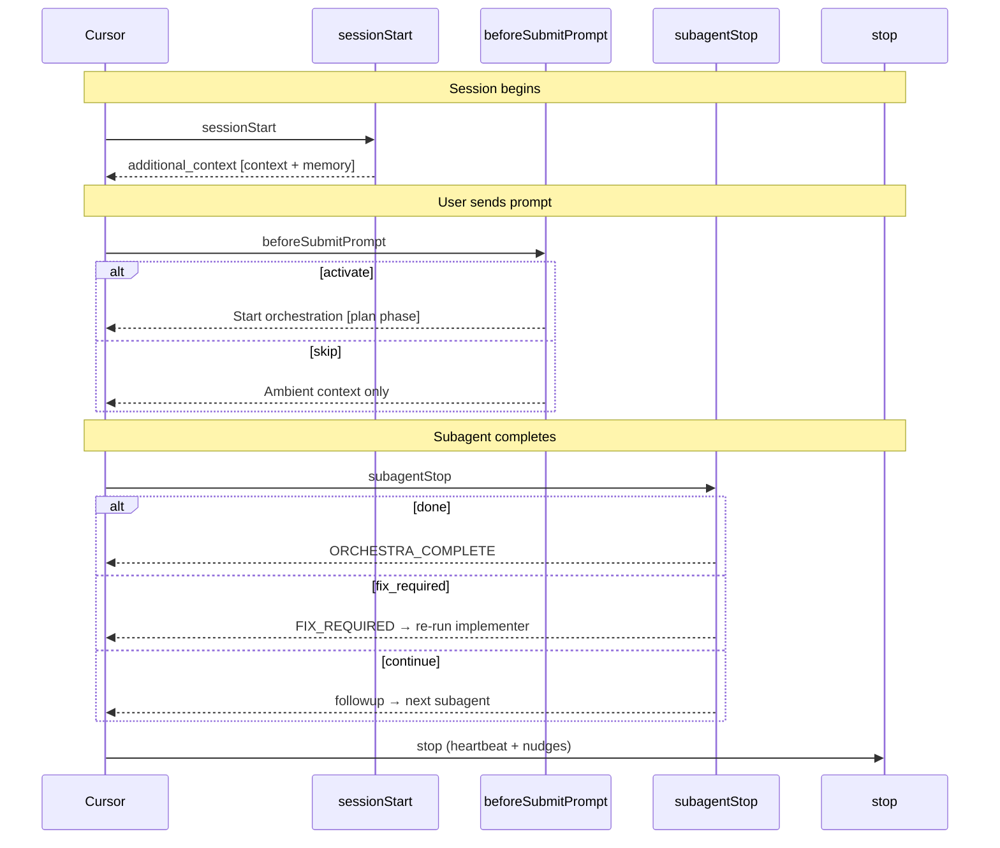
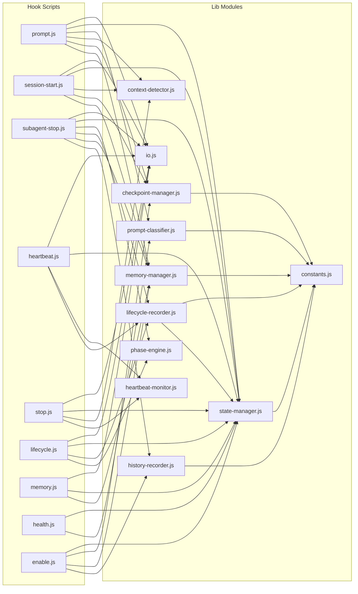

# P-Core Orchestra — Overview & Architecture

> **Project:** P-Core Orchestra (pcore-orchestra)
> **License:** MIT | **Maintainer:** P-Core System
> **Repository:** github.com/P-Core-System/pcore-orchestra
> **Status:** Production-ready v3.7 · **Docs version:** 3.7 (October 2026)

---

## Table of Contents

1. [Executive Summary](#1-executive-summary)
2. [Technology Stack](#2-technology-stack)
3. [Folder Structure](#3-folder-structure)
4. [Application Architecture](#4-application-architecture)
5. [System Architecture](#5-system-architecture)

---

# 1. Executive Summary

## Purpose

P-Core Orchestra provides **ambient multi-agent orchestration** for AI-assisted development environments. It automatically chains four specialized AI subagents — planner, implementer, verifier, reviewer — in sequence whenever a developer asks the AI to build, fix, or refactor code. The orchestration runs entirely locally on the developer's machine with zero external infrastructure dependencies.

## Business Problem

Modern AI coding assistants (Cursor, OpenCode CLI, Qoder CLI) are fundamentally stateless and single-agent: each prompt starts fresh with no memory, no verification pipeline, and no quality gate. Developers face:

- **No systematic verification** — AI writes code but doesn't test it
- **No planning phase** — AI jumps directly to implementation without researching the codebase
- **No quality review** — changes ship without a second opinion on security or conventions
- **Lost context across sessions** — each interaction is isolated, repeating the same mistakes
- **Manual orchestration** — developers must manually prompt each phase, breaking flow state

## Target Users

| User | Need |
|------|------|
| Software Developers using Cursor | Higher quality AI-generated code with automated verification |
| OpenCode CLI Users | Same orchestration in a terminal-based workflow |
| Qoder CLI Users | Same loop with converted agents and merged hook settings |
| Engineering Teams | Consistent code quality standards enforced automatically |
| Technical Leads | Enforce architecture invariants, code standards, and project conventions |

## Core Features

| Feature | Description |
|---------|-------------|
| **Ambient Auto-Start** | Activates automatically on implement/fix/build/refactor prompts |
| **4-Phase Pipeline** | Planner → Implementer → Verifier → Reviewer |
| **Six-File Context** | Injects project context (overview, architecture, standards, AI rules, progress) |
| **Convergence Criteria** | Tests pass → diff clean → lint clean → reviewer approves |
| **Stall Detection** | Heartbeat monitors progress; aborts after 2 consecutive stalls (5min threshold) |
| **Human Checkpoints** | Auth/payments/security/scope-creep trigger human review |
| **Token Budgets** | Planner 10k, Implementer 30k, Verifier 15k, Reviewer 8k (63k max/cycle) |
| **Crash Recovery** | Session restart mid-orchestration detected; offers resume from checkpoint |
| **Memory System** | Short-term (per-run) + long-term (persistent across sessions, 100 goal cap) |
| **Lifecycle Events** | Every phase transition, error, and completion recorded (200-event ring buffer) |
| **Git Workflow** | Only implementer commits; verifier checks clean tree; reviewer reviews diff |
| **Cross-Platform** | Bash (Unix) + PowerShell (Windows) installers |
| **Model Routing** | Cursor: `composer-2.5` default, `grok-4.6` for hard tasks; OpenCode: free models only |
| **Zero NPM Dependencies** | Core uses only Node.js built-in modules (`fs`, `path`, `child_process`) |

## Current Status

All core features complete (64 completed items). All critical and important code review issues resolved.

| Milestone | Status |
|-----------|--------|
| Core orchestration loop (V1) | ✅ Complete |
| V2 state model (lifecycle, heartbeat, memory, resumable) | ✅ Complete |
| Convergence criteria, stall detection, human checkpoints | ✅ Complete |
| Token budgets, crash recovery, long-term memory | ✅ Complete |
| Git workflow, self-review checklists, error-free rules | ✅ Complete |
| 13 Cloudflare skills + 17 Cursor built-in skills | ✅ Complete |
| Cross-platform installers, SMART/SWOT audit | ✅ Complete |

## Future Vision

| Priority | Feature | Description |
|----------|---------|-------------|
| P1 | Durable Skills | Skills that persist state across orchestration runs |
| P1 | Branch Isolation | Run orchestration in isolated git branches |
| P2 | MVP Mode | Skip reviewer for fast iterations |
| P2 | RAG / Codebase Indexing | Semantic code search for informed decisions |
| P3 | P-Core CLI | Unified CLI for all P-Core tools |

## Credits

- **Six-File Context Methodology** — JavaScript Mastery
- **Operator Loop Stack** — Jack Njoroge
- **Loop Engineering** — Kunal Ganglani, Addy Osmani, Peter Steinberger

---

# 2. Technology Stack

## Languages

| Language | Usage | Rationale |
|----------|-------|-----------|
| **JavaScript (Node.js)** | 11 hook scripts + 43 lib modules + CLI tool | Cursor hooks API spawns Node.js; CommonJS required |
| **TypeScript** | Cloudflare Worker template (turnstile-spin skill only) | Type safety for deployable Workers |
| **Markdown** | Agent definitions, skills, documentation, context files | Native format for Cursor/OpenCode agent prompts |
| **Bash** | Install scripts, bootstrap, setup scripts | Standard Unix shell, `set -euo pipefail` |
| **PowerShell** | Windows install + bootstrap | Windows-native, `$ErrorActionPreference = "Stop"` |
| **JSON** | State files, configuration | Universal structured data |
| **YAML Frontmatter** | Agent/skill metadata | Cursor/OpenCode standard for agent configuration |
| **TOML** | `wrangler.toml` (turnstile template only) | Cloudflare Workers config format |
| **MDC** | `orchestra-loop.mdc` | Cursor-specific markdown-code rule format |

## Runtimes / Platforms

| Platform | Version | Usage |
|----------|---------|-------|
| **Node.js** | 18+ (22.5+ for hybrid recall) | Runtime for all hook scripts — node built-ins only; `node:sqlite` (FTS memory) is optional |
| **Cursor IDE** | Latest | Primary target via hooks API (sessionStart, beforeSubmitPrompt, subagentStop, stop) |
| **OpenCode CLI** | Latest | Secondary target via skill system with `mode: subagent` agents |
| **Qoder CLI** | Latest | Third target: agents in `bundle/qoder/agents/`, hooks wired through `settings.json` |
| **Cloudflare Workers** | Latest | Worker template in turnstile-spin skill (optional, not core) |

## Libraries

**Core orchestra: zero npm dependencies.** The hook runtime uses only:

```
fs            — file system operations
path          — cross-platform path resolution
child_process — spawnSync (bridge.js, evidence runner, spawn adapter)
crypto / os   — hashing, temp paths
sqlite        — optional, built-in since Node 22.5 (FTS5 memory mirror)
```

**Why zero runtime dependencies?** Security (no supply chain), reliability (no conflicts), portability (any Node.js machine), simplicity (file copy install, no `npm install` for the hooks).

Separate optional packages exist outside the hook runtime:

- root `package.json` → `@modelcontextprotocol/sdk` (MCP server)
- `server/` → Studio API dependencies
- `studio/` → React/Vite dashboard dependencies
- turnstile-spin worker template → `wrangler`, `vitest`, `typescript`, `@cloudflare/workers-types` (devDependencies)

## Architectural Patterns

| Pattern | Usage | Why |
|---------|-------|-----|
| **Prompt Chaining + ReAct** | Sequential pipeline with reasoning inside each agent | Simplicity + adaptability |
| **Harness > Scaffold > Loop** | Three-layer architecture | Clean separation of runtime, behavior, and execution cycle |
| **Operator Loop Stack** | Jack Njoroge pattern | Production-grade with formal state, convergence, human escalation |
| **Six-File Context** | JavaScript Mastery methodology | Stable project grounding across sessions |
| **SOLID** | 11 single-purpose lib modules, command map, facade, specific imports | Maintainability, testability, extensibility |
| **Config-Driven** | PHASE_CHAIN object, COMMANDS map | Add phases/commands without logic changes |
| **Deep Merge Defaults** | `{...DEFAULT, ...loaded}` | V1→V2 migration without schema scripts |

## Design Principles

- Functions under 50 lines
- Max 3 levels of nesting
- Early returns, descriptive names
- No magic numbers (all in `lib/constants.js`)
- No commented-out code
- Error messages include context (what, why, what to do)
- Path isolation (each module resolves its own via `__dirname`)
- Single source of truth per concern

---

# 3. Folder Structure

```
pcore-orchestra/
├── AGENTS.md                  # Agent entry point (dogfooding)
├── README.md                  # Project documentation
├── LICENSE                    # MIT
├── .gitattributes             # LF line endings for .sh, .js, .md
├── .gitignore
│
├── bundle/                    # SOURCE PAYLOAD — installed to ~/.cursor/ and ~/.config/opencode/
│   ├── ORCHESTRA.md           # Global orchestra documentation
│   ├── hooks.json             # Cursor hook event bindings
│   │
│   ├── hooks/                 # CURSOR HOOK SCRIPTS (11 entry points + lib/ + state/)
│   │   ├── orchestra-enable.js         # CLI: status, start, stop, pause, resume, abort, memory, history
│   │   ├── orchestra-health.js         # Diagnostic health check
│   │   ├── orchestra-heartbeat.js      # Stall detection (stop hook)
│   │   ├── orchestra-lib.js            # Backward-compat facade (re-exports all lib/*)
│   │   ├── orchestra-lifecycle.js      # Lifecycle event logger (subagentStop)
│   │   ├── orchestra-memory.js         # Memory injection (subagentStop)
│   │   ├── orchestra-prompt.js         # Prompt classification + auto-start (beforeSubmitPrompt)
│   │   ├── orchestra-quality-gate.js   # Production checklist gate (final review)
│   │   ├── orchestra-session-start.js  # Context injection (sessionStart)
│   │   ├── orchestra-stop.js           # Phase nudges (stop)
│   │   └── orchestra-subagent-stop.js  # Phase chaining engine (subagentStop)
│   │   │
│   │   ├── lib/               # SHARED LIBRARY (43 modules + domain/ dashboard, mirrors/tickets)
│   │   │   ├── io.js                    # stdin/stdout helpers (readStdinJson, emit)
│   │   │   ├── constants.js             # 20 named numeric constants
│   │   │   ├── state-manager.js         # State CRUD + startOrchestra
│   │   │   ├── prompt-classifier.js     # 6 regex patterns, classification logic
│   │   │   ├── phase-engine.js          # Phase chain config + transitions
│   │   │   ├── lifecycle-recorder.js    # Events ring buffer + phase timers
│   │   │   ├── heartbeat-monitor.js     # Stall detection helpers
│   │   │   ├── memory-manager.js        # Short/long-term memory CRUD
│   │   │   ├── history-recorder.js      # Run history (50 cap)
│   │   │   ├── checkpoint-manager.js    # Pause/resume/abort/crash recovery
│   │   │   ├── context-detector.js      # Six-file workspace context detection
│   │   │   ├── memory-index.js          # JSON inverted index (goal recall)
│   │   │   ├── memory-fts.js            # SQLite FTS5 mirror (hybrid recall)
│   │   │   ├── semantic-memory.js       # BM25-lite token scoring
│   │   │   ├── phase-commit-gate.js     # Commit-before-next-phase gate
│   │   │   ├── evidence-runner.js       # Build/test/lint/security evidence gates
│   │   │   ├── security-scanner.js      # Secret/vulnerability scan rules
│   │   │   ├── safe-write.js            # Atomic writes, locks, quarantine
│   │   │   ├── ...                      # 25 more (see docs/04 Lib Modules)
│   │   │
│   │   └── state/             # Default state files
│   │       ├── orchestra.json           # V2 state schema
│   │       └── orchestra-memory.json    # Long-term memory
│   │
│   ├── agents/                # CORE LOOP AGENTS + SPECIALISTS (160 files, 5 category dirs)
│   │   ├── orchestra-planner.md         # readonly — research + plan
│   │   ├── orchestra-implementer.md     # implement code + commit
│   │   ├── orchestra-verifier.md        # readonly — test + lint
│   │   └── orchestra-reviewer.md        # readonly — security + scope review
│   │
│   ├── rules/
│   │   └── orchestra-loop.mdc           # Always-on Cursor rule
│   │
│   ├── skills/                # CURSOR SKILLS (38 skills)
│   │   ├── orchestra-loop/              # Core orchestration skill
│   │   ├── agents-sdk/                  # Cloudflare Agents SDK
│   │   ├── cloudflare/                  # General Cloudflare platform
│   │   ├── cloudflare-email-service/    # Email Service
│   │   ├── cloudflare-one/              # Zero Trust
│   │   ├── cloudflare-one-migrations/   # Migration planning
│   │   ├── durable-objects/             # Durable Objects
│   │   ├── sandbox-sdk/                 # Sandbox SDK
│   │   ├── turnstile-spin/              # Turnstile + deployable Worker template
│   │   ├── web-perf/                    # Web Performance
│   │   ├── workers-best-practices/      # Workers Best Practices
│   │   ├── wrangler/                    # Wrangler CLI
│   │   └── ...                          # ~25 more vendored + design skills
│   │
│   ├── skills-cursor/         # CURSOR BUILT-IN SKILLS (17 skills)
│   │   ├── babysit/                     # Controlled execution loop
│   │   ├── canvas/ + sdk/               # Canvas SDK types (15 .d.ts files)
│   │   ├── create-hook/                 # Hook creation
│   │   ├── create-rule/                 # Rule creation
│   │   ├── create-skill/                # Skill creation
│   │   ├── create-subagent/             # Subagent creation
│   │   ├── loop/                        # Agent loop
│   │   ├── migrate-to-skills/           # Migration
│   │   ├── review/                      # Code review
│   │   ├── review-bugbot/               # Bug detection
│   │   ├── review-security/             # Security review
│   │   ├── sdk/                         # Cursor SDK reference
│   │   ├── shell/                       # Shell commands
│   │   ├── split-to-prs/                # PR splitting
│   │   ├── statusline/                  # Status line
│   │   ├── update-cli-config/           # CLI config update
│   │   └── update-cursor-settings/      # Settings update
│   │
│   ├── qoder/                 # QODER MIRROR
│   │   └── agents/                      # 43 agents, generated by scripts/sync-qoder-agents.js
│   │
│   └── opencode/              # OPENCODE MIRROR (parallel structure)
│       ├── agents/                      # 43 agents (mode: subagent)
│       ├── hooks/orchestra-health-opencode.js
│       ├── hooks/lib/                   # byte-identical mirror of hooks/lib
│       ├── skills/                      # 38 skills
│       └── state/orchestra.json
│
├── context/                   # THIS REPO'S OWN SIX-FILE CONTEXT (dogfooding)
│   ├── harness-scaffold-loop.md         # Agent architecture hierarchy
│   ├── project-overview.md              # Product definition
│   ├── architecture.md                  # System structure + invariants
│   ├── code-standards.md                # Code conventions + SOLID
│   ├── ui-context.md                    # N/A (CLI/hooks only)
│   ├── ai-workflow-rules.md             # AI workflow + verification
│   └── progress-tracker.md             # Current state + decisions log
│
├── project-bridge/           # PER-REPO DELEGATION to global hooks
│   ├── hooks.json                       # Same events, targets bridge.js
│   └── hooks/bridge.js                  # spawnSync delegation (35 lines)
│
├── scripts/                  # BOOTSTRAP & SETUP
│   ├── init-context.sh / .ps1           # Six-file context bootstrap
│   ├── setup-cursor-byok.sh             # Cursor BYOK guide
│   ├── setup-opencode-optimal.sh        # Optimized config generator
│   └── setup-opencode-proxy.sh          # Free model proxy setup
│
├── templates/                # TARGET PROJECT TEMPLATES
│   ├── AGENTS.md                        # Entry point template
│   └── context/                         # 6 blank context file templates
│
└── docs/                      # PROJECT DOCUMENTATION
    ├── setup-guide.md                   # Complete setup (556 lines)
    ├── token-optimization.md            # Token efficiency + tracker
    ├── agent-harness-recommendations.md # Harness/loop/prompts research (Cursor + OpenCode)
    ├── opencode.json.example            # Balanced OpenCode orchestra profile
    ├── orchestration-patterns.md        # Patterns documentation (333 lines)
    ├── bypass-strategies.md             # BYOK + free models (342 lines)
    ├── audit-smart-swot.md              # SMART/SWOT analysis (265 lines)
    ├── plans/                           # Implementation plans
    └── [this file set]                  # Technical documentation
```

## Key File Roles

| File | Role |
|------|------|
| `bundle/hooks/lib/state-manager.js` | State CRUD (loadState, saveState, startOrchestra). Deep merge ensures V1→V2 backward compatibility. |
| `bundle/hooks/lib/prompt-classifier.js` | 6 regex patterns for prompt classification. Determines whether to auto-start orchestra. |
| `bundle/hooks/lib/phase-engine.js` | Config-driven phase chain (plan→implement→verify→review). Add a phase by adding a config entry. |
| `bundle/hooks/orchestra-subagent-stop.js` | Most complex hook. Handles phase transitions, FIX_REQUIRED loops, max iterations, completion. |
| `project-bridge/hooks/bridge.js` | 35-line delegation script. Essential for cloud Cursor agents that only load project hooks. |
| `bundle/opencode/skills/setup/SKILL.md` | OpenCode-only setup skill (not in Cursor). New machine + new project setup guide. |

---

# 4. Application Architecture

## Three-Layer Architecture: Harness > Scaffold > Loop



| Layer | Responsibility | Files |
|-------|----------------|-------|
| **Loop** | Phase chain execution, convergence criteria | `agents/*.md`, `lib/phase-engine.js` |
| **Scaffold** | Agent prompts, context injection, memory, policy | `agents/*.md`, `rules/*.mdc`, `lib/context-detector.js`, `lib/memory-manager.js` |
| **Harness** | Hook event handling, state persistence, CLI, error recovery | `hooks/orchestra-*.js`, `lib/state-manager.js`, `lib/checkpoint-manager.js` |

## Phase Model



## Request Flow



## Component Hierarchy



## Invariants

1. Hook scripts must exit quickly and emit valid JSON on stdout; never throw uncaught errors (`.catch(() => emit({}))`)
2. `orchestra-planner` is **readonly** — no file edits in plan phase
3. Installed hooks merge into existing `hooks.json`; never overwrite unrelated hook entries
4. `init-context` must not overwrite existing files without `--force`
5. Six-file read order is fixed: overview → architecture → code-standards → ui-context → ai-workflow-rules → progress-tracker
6. Context injection references paths relative to workspace root, not absolute machine paths

---

# 5. System Architecture

## Overall System



**Key property: The core orchestra is air-gapped — zero network calls.** The only network interaction is when the user manually deploys a turnstile-spin worker to Cloudflare.

## Platform Comparison

| Aspect | Cursor IDE | OpenCode CLI |
|--------|-----------|-------------|
| Integration | Hooks API (6 events) | Skill system + agent definitions |
| Agent format | `readonly: true` frontmatter | `mode: subagent` + `permission` |
| Orchestration trigger | `beforeSubmitPrompt` → `subagentStop` chain | `orchestra-loop` skill → Task tool |
| State persistence | `~/.cursor/hooks/state/` | `~/.config/opencode/state/` |
| Agent step limits | None | Planner 8, Impl 25, Ver 10, Rev 5 |
| Extra features | Heartbeat, lifecycle, stop nudges | Setup skill, model routing doc |

## Cursor Hooks Event Flow



## Internal Services (Lib Module Dependencies)



## Scaling Characteristics

| Dimension | Current | Limit | Notes |
|-----------|---------|-------|-------|
| Concurrent orchestrations | 1 | 1 | Single global state file |
| Max iterations | 8 | Configurable | Hard abort at limit |
| Lifecycle events | 200 | Ring buffer | Oldest evicted |
| Long-term memory goals | 100 | Capped | Oldest evicted |
| History runs | 50 | Capped | Oldest evicted |
| Stall threshold | 5 min | Configurable | Auto-abort after 2 |
| Token budget (per cycle) | 63k | Per-agent | Planner 10k, Impl 30k, Ver 15k, Rev 8k |
| Install size | ~3 MB | — | Zero npm packages needed |
