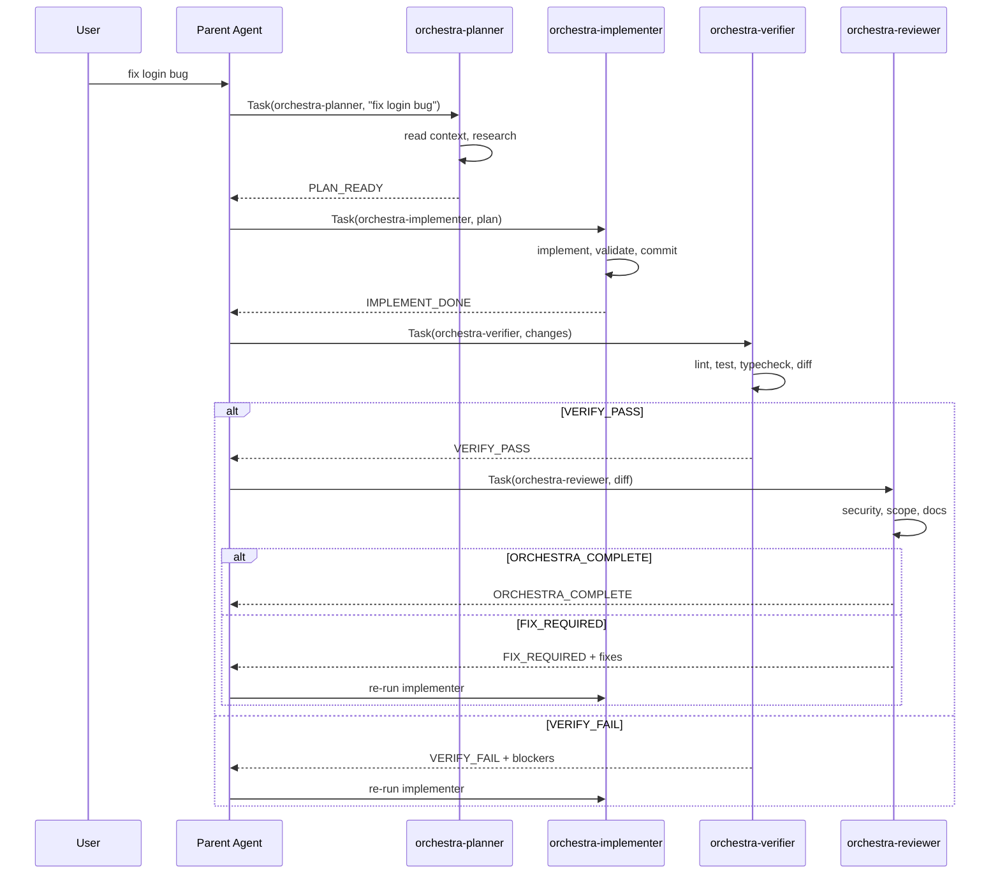

# P-Core Orchestra — Features, Hooks, Components & Agents

> **Project:** P-Core Orchestra | **Docs version:** 3.9 (October 2026) | **Docs map:** [index.md](index.md)

---

## Table of Contents

1. [Feature Documentation](#6-feature-documentation)
2. [Hooks API](#7-hooks-api)
3. [Component (Lib Module) Documentation](#8-component-lib-module-documentation)
4. [Agent Documentation](#9-agent-documentation)

---

# 6. Feature Documentation

## Feature Index

| # | Feature | Primary File | Category |
|---|---------|-------------|----------|
| 1 | Ambient Auto-Start | `orchestra-prompt.js` | Core |
| 2 | Phase Chaining | `orchestra-subagent-stop.js` | Core |
| 3 | Context Injection | `orchestra-session-start.js` | Integration |
| 4 | Stall Detection | `orchestra-heartbeat.js` | Reliability |
| 5 | Memory System | `orchestra-memory.js` | Persistence |
| 6 | Lifecycle Events | `orchestra-lifecycle.js` | Observability |
| 7 | Crash Recovery | `orchestra-prompt.js` + `checkpoint-manager.js` | Reliability |
| 8 | CLI Control | `orchestra-enable.js` | UX |
| 9 | Health Check | `orchestra-health.js` | Diagnostics |
| 10 | Stop Nudges | `orchestra-stop.js` | UX |
| 11 | Git Workflow | Agent definitions + `phase-engine.js` | DX |
| 12 | Six-File Context | `context-detector.js` | Integration |
| 13 | Project Bridge | `project-bridge/*` | Integration |
| 14 | Install System | `install.sh` / `install.ps1` | Distribution |
| 15 | OpenCode Integration | `bundle/opencode/*` | Multi-Platform |
| 16 | Conductor Run State | `conductor-state.js` + `scripts/conductor-state.sh` | Persistence |

---

## Feature 1: Ambient Auto-Start

On every `beforeSubmitPrompt` event, `orchestra-prompt.js` classifies the prompt using 9 regex patterns:

| Pattern | Regex | Matches |
|---------|-------|---------|
| **Question Only** | `/^(what is\|what are\|how does\|...)\b/i` | Explanatory questions |
| **Opt Out** | `/\b(no orchestra\|skip orchestra\|...)\b/i` | Explicit skip |
| **Opt In Explicit** | `/\b(\/orchestra\|orchestra loop\|...)\b/i` | Force start |
| **Implement** | `/\b(add\|implement\|build\|fix\|refactor\|...)\b/i` | Build/fix prompts (26 verbs) |
| **Trivial** | `/^(hi\|hello\|hey\|thanks\|...)\b/i` | Greetings |
| **Enterprise** | `ENTERPRISE_RE` | Opt-in enterprise SDLC route |
| **Complexity** | `COMPLEXITY_RE` | Multi-area / high-complexity signals |
| **Vague goal** | `VAGUE_GOAL_RE` | Short or vague goals infer from context |
| **Informal hint** | `INFORMAL_HINT_RE` | Casual phrasing without a clear verb |
| **Multistep** | 2+ "and"s, or contains "then/after that/also/next", or >120 chars | Complex tasks |

**Classification Flow:** `text → too_short? → trivial? → stop? → question? → opt_out? → ambient_disabled? → implement? → multistep? → activate`

```javascript
// Priority order (first match wins):
const result = classifyPrompt(text, state);
// → { activate: false/true, reason: string, goal?: string }
```

**Configuration:** `PROMPT_MIN_LENGTH=8`, `GOAL_MAX_LENGTH=2000`, `CLASSIFICATION_MULTISTEP_MIN_LENGTH=120`

---

## Feature 2: Phase Chaining

On `subagentStop`, the phase engine looks up the completed subagent in `PHASE_CHAIN`:

```javascript
const PHASE_CHAIN = {
  "orchestra-planner":     { nextPhase: "implement", followup: "..." },
  "orchestra-implementer": { nextPhase: "verify",    followup: "..." },
  "orchestra-verifier":    { nextPhase: "review",    followup: "..." },
  "orchestra-reviewer":    { nextPhase: "done",      followup: null }
};
```

**FIX_REQUIRED Detection** — searches subagent output for `FIX_REQUIRED` or `VERIFY_FAIL` patterns. If found, sets phase back to "implement" and increments iteration. If `iteration >= max_iterations` (default 8), aborts.

**Loop limit:** 12 (safety guard in hooks.json).

---

## Feature 3: Context Injection

On `sessionStart`, extracts workspace roots from input JSON, checks for `context/` directory, builds injection block:

```
Six-File Context detected in this workspace:
1. context/project-overview.md — product definition ✓
2. context/architecture.md     — system structure ✓
...
```

Long-term memory is also injected (recent goals, frequent files, error patterns).

---

## Feature 4: Stall Detection

On every `stop` event, `orchestra-heartbeat.js`:
1. Updates `heartbeat.last_beat` timestamp
2. Checks if `elapsed > stall_threshold_ms` (default 300,000ms = 5 min)
3. First stall → emit nudge to re-launch subagent
4. Second stall → abort orchestration

```javascript
DEFAULT_STALL_THRESHOLD_MS = 300000;    // 5 minutes
STALL_ATTEMPTS_ABORT_THRESHOLD = 2;     // abort after 2 consecutive
```

---

## Feature 5: Memory System

**Short-term memory** (in `orchestra.json`, per-run):
- `phases_completed[]`, `files_changed[]`, `errors[]`, `decisions[]`, `context_summary`

**Long-term memory** (in `orchestra-memory.json`, persistent):
- `completed_goals[]` — max 100
- `recent_files[]` — max 50, tracks modification count
- `error_patterns[]` — max 50, tracks recurrence

**Recall:** completed goals are also indexed in `memory-index.json` (JSON inverted index, capped at 500) and mirrored into `memory-fts.db` (SQLite FTS5 via the built-in `node:sqlite`). Index entries keep lessons, duration, and phase count so index hits render like semantic hits. The JSON half ranks by IDF (rare query tokens dominate) and `searchMemoryIndex` fuses both rankings with reciprocal rank fusion; each hit carries `score` and `sources` (`json`/`fts`). The FTS half is best-effort — `PCORE_FTS_DISABLE=1`, a missing `node:sqlite`, or an unwritable state dir degrades recall to the JSON index without failing the write. Injected context suppresses goals already shown by semantic recall.

**Learning:** `learnProjectPattern()` runs on every completed run — detects package manager + test framework from lockfiles/manifests and records the task type, changed files, and stack per project (identical repeats deduped); `buildPatternContext()` surfaces them to the planner. `plan_outcomes` recorded at verify/review feed a planning warning when the same task type needed fixes in ≥2 of ≥3 recent checks, including recurring error labels.

**Flush:** On completion/abort/max-iterations, short-term is flushed to long-term via `flushShortToLong()`. Memory is injected at session start, orchestration start, and first implementer invocation.

**CLI:** `node ~/.cursor/hooks/orchestra-enable.js memory [clear]`

---

## Feature 6: Lifecycle Events

10 event types recorded in a 200-entry ring buffer:

| Event Type | Trigger | When |
|-----------|---------|------|
| `orchestra_start` | startOrchestra() | Orchestration begins |
| `orchestra_complete` | Phase chain → done | Successful completion |
| `phase_advance` | subagentStop | Phase transition |
| `phase_complete` | subagentStop | Phase finished |
| `fix_required` | Reviewer FIX_REQUIRED | Fix loop initiated |
| `max_iterations` | Iteration >= max | Loop aborted |
| `stall_detected` | Heartbeat > threshold | Phase stall |
| `stall_aborted` | 2nd consecutive stall | Aborted |
| `subagent_complete` | Lifecycle hook | Subagent finished |
| `subagent_error` | Status != completed | Subagent error |

Phase timers track `started_at`, `ended_at`, `duration_ms` for each phase.

---

## Feature 7: Crash Recovery

**Detection:** `detectCrashRecovery(state)` checks if heartbeat is stale (>10 min) or state is stale (>10 min). If `state.active && stale`, marks as crash recovery.

**Recovery:** User says "resume orchestra" → `resumeOrchestra(state)` restores from checkpoint → appropriate subagent launched.

**Checkpoint schema:**
```json
{
  "phase": "implement", "goal": "fix login bug",
  "iteration": 2, "last_subagent": "orchestra-implementer",
  "started_at": "...", "lifecycle_snapshot": [...20 events],
  "memory_snapshot": {...}, "timestamp": "..."
}
```

**CLI:** `pause [reason]`, `resume`, `checkpoint`, `abort [reason]`

---

## Feature 8-16: Quick Reference

| Feature | Key Detail |
|---------|-----------|
| **CLI Control** | 12 commands via COMMANDS map (plugin-like, OCP): status, stop, pause, resume, start, memory, checkpoint, abort, history, tokens, metrics, cycles |
| **Health Check** | 10 categories: scripts, lib modules, hooks.json, state, memory, classification (6 samples), agents, enterprise state files, project identity, adaptive install |
| **Stop Nudges** | Phase-specific nudges, capped at 3 per phase (`STOP_NUDGE_LOOP_LIMIT`=3) |
| **Git Workflow** | Only implementer commits (`<type>(<scope>): <desc>`). Verifier checks `git status --porcelain` |
| **Six-File Context** | 6 files read in fixed order. Missing files noted (○) but still works. Bootstrap via `init-context.sh` |
| **Project Bridge** | 35-line `bridge.js` delegates from project hooks to global via `spawnSync`. Enables cloud agents |
| **Install System** | Bash + PowerShell. Copies bundle, merges hooks.json (dedup by command), creates symlinks |
| **OpenCode Integration** | `mode: subagent` instead of `readonly: true`. Explicit permissions. Extra `setup/` skill |
| **Conductor Run State** | Per-run `conductor-runs/` records keyed by workspace+session+task (`begin`/`save`/`who`/`resume` via `scripts/conductor-state.sh`), atomic and isolation-safe |

---

# 7. Hooks API

## Hook Contract

```
stdin:  JSON object (Cursor passes event payload)
stdout: JSON object (returns additional_context / followup_message)
exit:   0 (always)
pattern: async main() → process → emit → .catch(() => emit({}))
```

## Hook Table

| Event | File | When | Timeout | Output |
|-------|------|------|---------|--------|
| `sessionStart` | `orchestra-session-start.js` | Session/workspace open | None | `additional_context` (context + memory) |
| `beforeSubmitPrompt` | `orchestra-prompt.js` | User submits prompt | 5s | `additional_context` (classification result) |
| `subagentStop` | `orchestra-subagent-stop.js` | Subagent completes | None | `followup_message` (next phase) |
| `subagentStop` | `orchestra-lifecycle.js` | (concurrent) | None | `{}` (records events) |
| `subagentStop` | `orchestra-memory.js` | (concurrent) | None | `additional_context` (memory, first implement only) |
| `subagentStop` | `orchestra-quality-gate.js` | (concurrent) | None | `additional_context` (gate verdicts + six-file gaps) |
| `stop` | `orchestra-stop.js` | Every message | None | `followup_message` (phase nudge, cap 3) |
| `stop` | `orchestra-heartbeat.js` | (concurrent) | None | `followup_message` (stall nudge or abort) |

Three further entry points are not hook events: `orchestra-enable.js` (manual activation
CLI), `orchestra-health.js` (self-check), and `orchestra-lib.js` (shared helpers).

## Hook Input Fields (from hosts)

| Field | Type | Events |
|-------|------|--------|
| `prompt` | string | `beforeSubmitPrompt` |
| `status` | string | `subagentStop`, `stop` |
| `subagent_type` / `subagentType` | string | `subagentStop` |
| `agent_type` / `agentType` | string | `subagentStop` (normalized to `subagent_type` on Qoder) |
| `session_id` / `sessionId` | string | Cursor `sessionStart`/`sessionEnd`, Qoder `SubagentStop`/`Stop` (seeds `PCORE_SESSION_ID` when no native host id is set) |
| `conversation_id` / `conversationId` | string | Cursor's canonical id on every other event (also seeds `PCORE_SESSION_ID`) |
| `workspace_roots` / `workspaceRoots` | string[] | `sessionStart`, `beforeSubmitPrompt` |
| `loop_count` | number | `stop` |
| `summary` / `result` / `output` / `final_text` | string | `subagentStop` |
| `error` / `error_message` | string | `subagentStop` |

Host detection order is Cursor (`CURSOR_TRACE_ID`), OpenCode (`OPENCODE_SESSION_ID`),
Claude Code, Codex, then Qoder (`QODER_CLI` / `QODER_PID` / `QODER_SESSION_ID`, or an
installed `~/.qoder` hook path). Session ids follow the same precedence and fall back to
`QODER_PID` before `pid-<process>`, so Qoder hook processes share one state session instead
of creating a new one per event.

## Hook Output Fields

| Field | Description |
|-------|-------------|
| `additional_context` | Text injected into agent's context window |
| `followup_message` | Text sent as user follow-up message |
| `{}` | Empty object when hook has nothing to contribute |

## hooks.json Registration

```json
{
  "version": 1,
  "hooks": {
    "sessionStart": [
      { "command": "node ./hooks/orchestra-session-start.js" }
    ],
    "beforeSubmitPrompt": [
      { "command": "node ./hooks/orchestra-prompt.js", "matcher": "UserPromptSubmit", "timeout": 5 }
    ],
    "subagentStop": [
      { "command": "node ./hooks/orchestra-subagent-stop.js", "matcher": "orchestra-planner|orchestra-implementer|orchestra-verifier|orchestra-reviewer", "loop_limit": 12 },
      { "command": "node ./hooks/orchestra-lifecycle.js", "matcher": "orchestra-planner|orchestra-implementer|orchestra-verifier|orchestra-reviewer", "loop_limit": 12 },
      { "command": "node ./hooks/orchestra-memory.js", "matcher": "orchestra-planner|orchestra-implementer|orchestra-verifier|orchestra-reviewer", "loop_limit": 12 },
      { "command": "node ./hooks/orchestra-quality-gate.js", "matcher": "orchestra-reviewer|code-reviewer|release-manager", "loop_limit": 5 }
    ],
    "stop": [
      { "command": "node ./hooks/orchestra-stop.js", "loop_limit": 5 },
      { "command": "node ./hooks/orchestra-heartbeat.js", "loop_limit": 5 }
    ]
  }
}
```

The matcher lists shown above are abbreviated; the shipped `hooks.json` matchstrings are
generated from `bundle/agent-registry.json` and cover all 27 hook agents.

## Hook Execution Order per Subagent Cycle

```
sessionStart → context + memory
beforeSubmitPrompt → classification + auto-start
  └→ subagentStop (planner) + lifecycle + memory (concurrent)
      └→ subagentStop (implementer) + lifecycle + memory
          └→ subagentStop (verifier) + lifecycle + memory
              └→ subagentStop (reviewer) + lifecycle + memory + quality gate → complete | FIX_REQUIRED
```

---

# 8. Component (Lib Module) Documentation

## Module Map

`bundle/hooks/lib/` contains 43 single-responsibility modules, plus the 8-module
`domain/` event-sourcing package (`entities`, `state-machine`, `store`, `evidence`,
`completion`, `review-queue`, `constants`, `index`).

| Group | Modules |
|-------|---------|
| Runtime + state | `io`, `constants`, `safe-write`, `state-manager` (session-scoped), `workspace-identity`, `conductor-state`, `checkpoint-manager` |
| Loop control | `prompt-classifier`, `phase-engine`, `phase-outcome`, `phase-commit-gate`, `handoff-enforcer`, `quality-gate`, `orchestra-config`, `context-detector`, `greenfield-intake`, `greenfield-scaffold` |
| Memory + recall | `memory-manager`, `memory-index`, `memory-fts`, `semantic-memory`, `plan-artifact`, `cycle-report` |
| Evidence + security | `evidence-runner`, `evidence-record`, `security-scanner`, `harness-observability`, `observability` |
| Enterprise project | `project-identity`, `project-manager`, `version-manager`, `daily-planner`, `devops`, `self-improvement`, `metrics-report` |
| Orchestration + hosts | `spawn-adapter`, `orchestra-spawn-matrix`, `worktree-manager`, `mcp-server`, `knowledge-tools`, `token-tracker`, `history-recorder` |
| Loop telemetry | `lifecycle-recorder`, `heartbeat-monitor` |

Key modules:

| Module | Lines | Responsibility | Exports |
|--------|-------|----------------|---------|
| `io.js` | 45 | stdin/stdout JSON + Qoder input normalization | `readStdinJson()`, `emit()`, `normalizeHookInput()` |
| `constants.js` | 205 | All numeric constants | 55 named constants |
| `state-manager.js` | 539 | Session-scoped state CRUD, V2 deep merge | `loadState()`, `saveState()`, `startOrchestra()`, `getSessionState()` |
| `conductor-state.js` | 389 | Per-run conductor state, atomic + isolation-keyed | `beginRun()`, `saveRun()`, `listRuns()`, `heartbeat()`, `completeRun()` |
| `prompt-classifier.js` | 247 | Prompt extraction + classification | `extractPrompt()`, `classifyPrompt()`, `selectRoute()` |
| `phase-engine.js` | 242 | Phase chains, categories, transitions | `getPhasesForMode()`, `getAgentForPhase()`, `advancePhase()`, `reviewerNeedsFix()` |
| `memory-manager.js` | 611 | Long-term memory CRUD + context builders | `loadLongTermMemory()`, `flushShortToLong()`, `buildMemoryContext()`, `buildPatternContext()`, `learnProjectPattern()` |
| `memory-index.js` | 120 | Goal inverted index + hybrid fusion | `indexCompletedGoal()`, `searchMemoryIndex()` |
| `memory-fts.js` | 102 | Optional SQLite FTS5 mirror | `ftsAvailable()`, `indexGoalFts()`, `searchFts()`, `removeFts()` |
| `heartbeat-monitor.js` | 26 | Stall detection | `writeHeartbeat()`, `isStalled()`, `getStallDurationMs()` |
| `lifecycle-recorder.js` | 51 | Events + phase timers | `emitLifecycleEvent()`, `startPhaseTimer()`, `endPhaseTimer()` |

## Constants Table (most-used; full set in `constants.js`)

`constants.js` exports 55 named constants. The ones read most often:

| Constant | Value | Used By |
|----------|-------|---------|
| `LIFECYCLE_MAX_EVENTS` | 200 | lifecycle-recorder |
| `MEMORY_MAX_COMPLETED` | 100 | memory-manager |
| `MEMORY_MAX_RECENT_FILES` | 50 | memory-manager |
| `MEMORY_MAX_ERROR_PATTERNS` | 50 | memory-manager |
| `HISTORY_MAX_RUNS` | 50 | history-recorder |
| `PROMPT_MIN_LENGTH` | 8 | prompt-classifier |
| `GOAL_MAX_LENGTH` | 2000 | prompt-classifier |
| `CLASSIFICATION_MULTISTEP_MIN_LENGTH` | 120 | prompt-classifier |
| `DEFAULT_MAX_ITERATIONS` | 8 | state-manager |
| `DEFAULT_STALL_THRESHOLD_MS` | 300000 (5 min) | heartbeat-monitor |
| `DEFAULT_HEARTBEAT_INTERVAL_MS` | 60000 (1 min) | state-manager |
| `DEFAULT_STALE_THRESHOLD_MS` | 600000 (10 min) | checkpoint-manager |
| `CRASH_RECOVERY_THRESHOLD_MS` | 600000 (10 min) | checkpoint-manager |
| `RECENT_GOALS_DISPLAY_COUNT` | 5 | memory-manager |
| `TOP_FILES_DISPLAY_COUNT` | 5 | memory-manager |
| `TOP_ERRORS_DISPLAY_COUNT` | 3 | memory-manager |
| `STALL_ATTEMPTS_ABORT_THRESHOLD` | 2 | heartbeat-monitor |
| `STOP_NUDGE_LOOP_LIMIT` | 3 | orchestra-stop.js |

## Key Module Details

### `state-manager.js` — Deep Merge Defaults

```javascript
function loadState() {
  const raw = JSON.parse(fs.readFileSync(STATE_PATH, "utf8"));
  const merged = { ...DEFAULT_STATE, ...raw };
  merged.lifecycle = { ...DEFAULT_STATE.lifecycle, ...merged.lifecycle };
  merged.heartbeat = { ...DEFAULT_STATE.heartbeat, ...merged.heartbeat };
  merged.memory = { ...DEFAULT_STATE.memory, ...merged.memory };
  merged.resumable = { ...DEFAULT_STATE.resumable, ...merged.resumable };
  merged.version = 2;
  return merged;
}
```

Ensures V1→V2 backward compatibility. Missing fields get defaults without migration scripts.

### `conductor-state.js` — Atomic Run Isolation

Each orchestra loop writes an isolated atomic run `<baseDir>/<ws>/<sid>/<tid>.json` (`baseDir = PCORE_CONDUCTOR_STATE_DIR || ~/.config/opencode/hooks/state/conductor-runs`), keyed by (workspace slug + session id + 12-hex task id), plus a shared `index.json` registry of live sessions/tasks. `beginRun()` is idempotent — a live run on the same key resumes and preserves `startedAt`; every write is tmp+rename with 3-retry backoff; `isStale`/`findStale`/`gcRuns` handle stall detection and cleanup; `migrateLegacy()` folds the old flat `~/.config/opencode/state/orchestra-state.json` in exactly once. Driven by `scripts/conductor-state.sh` (`begin / save / heartbeat / list / who / resume / complete / fail / gc`).

### `checkpoint-manager.js` — Crash Recovery

```javascript
function detectCrashRecovery(state) {
  if (!state.active) return null;
  const lastBeat = state.heartbeat?.last_beat;
  if (lastBeat && Date.now() - new Date(lastBeat).getTime() > CRASH_RECOVERY_THRESHOLD_MS)
    return { phase, goal, iteration, last_activity: lastBeat };
  if (isStaleState(state)) return crashInfo;
  return null;
}
```

### `context-detector.js` — Six-File Context

Detects `context/` directory in workspace roots. Injects file list and read order:

```
Six-File Context detected in this workspace:
Entry point: `AGENTS.md` at project root.
Read in order:
1. context/project-overview.md — product definition ✓
2. context/architecture.md — system structure ✓
...
```

### `prompt-classifier.js` — Classification Algorithm

```javascript
IMPLEMENT_RE = /\b(add|implement|build|create|fix|refactor|update|deploy|install|setup|configure|migrate|integrate|wire|hook up|write tests|add tests|ship|continue|finish|complete|resolve|debug|patch|scaffold|generate|make it work|get it working|push to|commit)\b/i;
```

---

# 9. Agent Documentation

## Agent Overview

4 specialized subagents execute the core loop in sequence (the enterprise route
additionally routes to the 155 specialist agents in `bundle/agents/<category>/`):

| Agent | Phase | Readonly | End Marker | Token Budget |
|-------|-------|----------|------------|--------------|
| `orchestra-planner` | 1 — Plan | ✅ | `PLAN_READY` | 10,000 |
| `orchestra-implementer` | 2 — Implement | ❌ | `IMPLEMENT_DONE` | 30,000 |
| `orchestra-verifier` | 3 — Verify | ✅ | `VERIFY_PASS` / `VERIFY_FAIL` | 15,000 |
| `orchestra-reviewer` | 4 — Review | ✅ | `ORCHESTRA_COMPLETE` / `FIX_REQUIRED` | 8,000 |

**Cursor agents** use `readonly: true` frontmatter. **OpenCode agents** use `mode: subagent` + `permission: { edit: deny, bash: allow }` (readonly phases still deny edit; bash allow avoids inspection prompts). **Qoder agents** use `disallowedTools: [Write, Edit, NotebookEdit]` for readonly phases and full tools for the implementer. Every agent also carries an explicit `tools:` allowlist derived from its `readonly` policy by `scripts/enrich-agent-capabilities.js`; `bundle/agent-registry.json` (v2) records the same allowlist under `agentDetails[*].capabilities`, and `scripts/test-agent-capabilities.js` fails when files, registry, and skill metadata disagree.

**Model defaults:** Cursor agents are pinned to `composer-2.5` (escalate to `grok-4.6` standard for hard/long-horizon tasks). OpenCode agents use free models only — they **inherit the global `model`** set by `scripts/update-free-models.sh --apply` (highest-stability probe-reachable free model, currently `opencode/big-pickle`) — never per-agent pins. See `docs/token-optimization.md` and `docs/orchestra-cross-platform.md`.

## Agent: orchestra-planner

**Workflow:**
1. Read project context (6 files in order) + long-term memory
2. Read user goal from parent message
3. Search codebase only as needed — no implementation
4. Output structured plan (goal, context alignment, approach, files, git strategy, risks, done-when)
5. Limit: under 100 lines (Cursor) / 80 lines (OpenCode)
6. End with `PLAN_READY`

**Self-review checklist:** Goal clear? Files exist? Approach maps to files? Done-when testable? Invariants safe? Plan under limit?

**Error-free rules:** Don't list unverified files. Don't assume API/patterns without checking. Don't include "nice to have". Document unknowns in risks.

## Agent: orchestra-implementer

**Workflow:**
1. Re-read `code-standards.md` and `architecture.md`
2. Implement only what the plan specifies — no scope creep
3. Match existing project conventions (read surrounding files)
4. Run quick validation (syntax, targeted tests)
5. **Commit changes** after ALL implementation — only committer in the chain
6. Output: Implemented list, files changed, validation results, commit status/SHA, notes for verifier
7. End with `IMPLEMENT_DONE`

**Git workflow:**
```bash
git status                    # verify only intended files
git diff                      # review all changes
git add <files>               # stage only plan files
git commit -m "<type>(<scope>): <description>"
git log --oneline -1          # confirm
```

**Zero-tolerance rules:** Syntax errors, debug code, secrets, scope creep.

## Agent: orchestra-verifier

**Core principle:** "Tests must pass before VERIFY_PASS. No exceptions."

**Checklist (run in order):**
1. Lint — project linter
2. Typecheck — `tsc --noEmit`
3. Unit tests — project test runner
4. Build — `npm run build`
5. Git clean — `git status --porcelain`
6. Diff review — `git diff --stat`
7. Import check — unused imports or missing deps

**Convergence criteria:** Tests pass → lint clean → typecheck pass → git clean.

**Verdict discipline:** the outcome hook scans the output backwards and takes the **last line carrying a phase token** as the verdict. A trailing `VERIFY_PASS` therefore wins over prose that quotes an earlier `VERIFY_FAIL`; a trailing `VERIFY_FAIL` wins over optimistic prose. The token must be the verdict itself, and a pass verdict with a red required gate is converted to a `phase_blocked` block. Every check row is binary (PASS / FAIL / `SKIPPED: reason`) with the command and one-line result as evidence.

**Stall detection (in agent):** Identical failures 2x → suggest different strategy. 3rd → recommend abort. After 2 fix cycles the handoff also carries an `Escalation` line (root-cause + split scope, then escalate to `grok-4.6` if still red).

## Agent: orchestra-reviewer

**Core principle:** "If in doubt, FIX_REQUIRED. Don't approve risky changes."

**Quality gates (must pass all):**
- [ ] Implementation matches plan (no scope creep)
- [ ] No architecture invariants violated
- [ ] Code follows project conventions
- [ ] Tests exist and pass (verifier confirmed)
- [ ] No security issues (secrets, injection, auth bypass)
- [ ] Documentation updated if public API changed
- [ ] progress-tracker.md reflects completed work

**Human checkpoint triggers:** Auth/payments/security/scope-creep/budget-exhaustion/3rd consecutive FIX_REQUIRED.

**Verdict discipline:** `ORCHESTRA_COMPLETE` or `FIX_REQUIRED` on the final non-empty line. Review only recognises its own two tokens, so findings that quote `VERIFY_FAIL` cannot force a fix replay; a pass verdict with a red required gate is converted to a block.

**Output includes:** Critical findings (file:line), suggestions, context drift, git review, lessons for long-term memory.

## Agent Orchestration Flow


