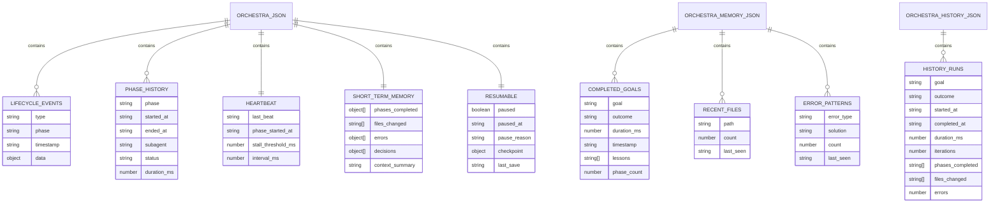
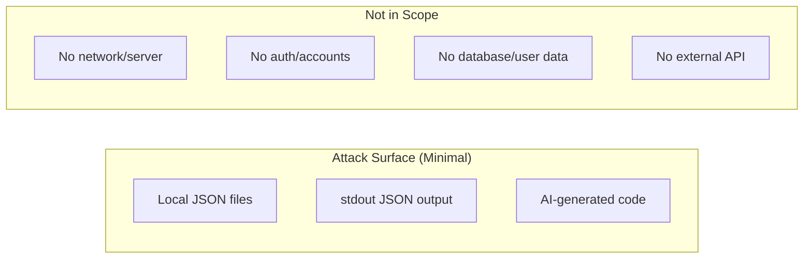

# P-Core Orchestra — Database, Security, Testing & Limitations

> **Project:** P-Core Orchestra | **Docs version:** 3.7 (October 2026) | **Docs map:** [index.md](index.md)

---

## Table of Contents

1. [Database & State](#10-database--state)
2. [Security](#11-security)
3. [Testing & Deployment](#12-testing--deployment)
4. [Known Limitations & Roadmap](#13-known-limitations--roadmap)

---

# 10. Database & State

## Overview

P-Core Orchestra has **no database**. All persistence is through local JSON files:

| File | Location | Purpose | Max Size |
|------|----------|---------|----------|
| `orchestra.json` | `~/.cursor/hooks/state/` | Active orchestration state (V2) | ~2KB |
| `orchestra-memory.json` | `~/.cursor/hooks/state/` | Long-term memory | ~10KB |
| `orchestra-history.json` | `~/.cursor/hooks/state/` | Run history (auto-created) | ~20KB |

OpenCode stores state at `~/.config/opencode/state/orchestra.json`.

## State Schema: `orchestra.json` (V2)

```json
{
  "version": 2,
  "ambient": true,
  "active": false,
  "goal": "",
  "phase": "idle",
  "started_at": null,
  "last_subagent": null,
  "iteration": 0,
  "max_iterations": 8,
  "last_prompt": null,
  "auto_started": null,
  "lifecycle": {
    "events": [],
    "phase_history": []
  },
  "heartbeat": {
    "last_beat": null,
    "phase_started_at": null,
    "stall_threshold_ms": 300000,
    "interval_ms": 60000
  },
  "memory": {
    "phases_completed": [],
    "files_changed": [],
    "errors": [],
    "decisions": [],
    "context_summary": ""
  },
  "resumable": {
    "paused": false,
    "paused_at": null,
    "pause_reason": null,
    "checkpoint": null,
    "last_save": null
  }
}
```

### Field Groups

| Section | Fields | Purpose |
|---------|--------|---------|
| **Top-level** | `version`, `ambient`, `active`, `goal`, `phase`, `iteration`, `max_iterations`, `started_at`, `last_subagent`, `auto_started` | Core orchestration state |
| **lifecycle** | `events[]` (200 cap), `phase_history[]` | Event log + phase timing |
| **heartbeat** | `last_beat`, `phase_started_at`, `stall_threshold_ms`, `interval_ms` | Stall detection |
| **memory** | `phases_completed[]`, `files_changed[]`, `errors[]`, `decisions[]` | Short-term (per-run) memory |
| **resumable** | `paused`, `checkpoint`, `pause_reason`, `last_save` | Pause/resume/crash recovery |

### Lifecycle Event Types

| Event | When |
|-------|------|
| `orchestra_start` | startOrchestra() called |
| `orchestra_complete` | Phase chain reaches "done" |
| `phase_advance` | Phase transition after subagent |
| `phase_complete` | Phase finished (endPhaseTimer) |
| `fix_required` | Reviewer outputs FIX_REQUIRED |
| `max_iterations` | Iteration >= max_iterations |
| `stall_detected` | Heartbeat detects stall |
| `stall_aborted` | 2nd consecutive stall |
| `subagent_complete` | Subagent status=completed |
| `subagent_error` | Subagent status!=completed |

### Checkpoint Schema (in resumable.checkpoint)

```json
{
  "phase": "implement",
  "goal": "fix login bug",
  "iteration": 2,
  "last_subagent": "orchestra-implementer",
  "started_at": "2026-07-13T14:00:00.000Z",
  "lifecycle_snapshot": [...last 20 events],
  "memory_snapshot": {...},
  "timestamp": "2026-07-13T14:05:00.000Z"
}
```

## Memory Schema: `orchestra-memory.json`

```json
{
  "version": 1,
  "completed_goals": [
    { "goal": "fix login bug", "outcome": "completed", "duration_ms": 300000,
      "timestamp": "...", "lessons": ["Use try-catch"], "phase_count": 4 }
  ],
  "project_patterns": {},
  "recent_files": [
    { "path": "src/auth/login.ts", "count": 3, "last_seen": "..." }
  ],
  "error_patterns": [
    { "error_type": "TypeScript compilation error...", "count": 3, "last_seen": "..." }
  ],
  "user_preferences": {}
}
```

**Caps:** 100 goals, 50 files, 50 errors (oldest evicted on save).

## History Schema: `orchestra-history.json`

```json
[{
  "goal": "fix login bug",
  "outcome": "completed",
  "started_at": "...", "completed_at": "...",
  "duration_ms": 300000,
  "iterations": 4,
  "phases_completed": ["plan","implement","verify","review"],
  "files_changed": ["src/auth/login.ts"],
  "errors": 0
}]
```

**Cap:** 50 runs (oldest evicted).

## Migration History

| Version | Date | Changes |
|---------|------|---------|
| V1 | 2026-07-12 | Initial: `version`, `ambient`, `active`, `goal`, `phase`, `started_at`, `last_subagent`, `iteration`, `max_iterations` |
| V2 | 2026-07-13 | Added `lifecycle`, `heartbeat`, `memory`, `resumable`. Deep merge handles migration transparently — no script needed. |

## ER Diagram



## Performance Notes

- `loadState()`: <1ms (~1KB JSON)
- `saveState()`: <5ms (~1KB JSON)
- All operations are synchronous and fast. No database connection overhead.
- State files safe to backup by simple file copy.

---

# 11. Security

## Security Model

**Local-only, no network endpoints, no authentication, no user accounts, no external API calls.**



## Authentication & Authorization

**Not applicable.** No authentication system. No user accounts. No login.

Authorization is enforced at the agent level:

| Agent | Cursor | OpenCode |
|-------|--------|----------|
| Planner | `readonly: true` | `permission: { edit: deny, bash: allow }` |
| Implementer | Full access | Full access |
| Verifier | `readonly: true` | No restriction |
| Reviewer | `readonly: true` | `permission: { edit: deny, bash: allow }` |

## CSP, CSRF, XSS, SQL Injection

**All not applicable.** No web UI, no HTTP endpoints, no database, no SQL queries. The only output is stdout JSON and markdown in Cursor chat.

## Validation

| Input | Validation |
|-------|------------|
| stdin JSON | Try-catch JSON.parse; empty object on failure |
| Prompt text | Min 8 chars, regex classification |
| Goal text | Truncated to 2000 chars |
| Subagent type | Looked up in PHASE_CHAIN; unknown = no-op |
| Workspace roots | Resolved to absolute, deduplicated |

## Rate Limiting

**Not applicable.** All processing is local. Hooks are serialized by Cursor. The only "rate limit" is Cursor's own hook loop limits (12 subagentStop, 5 stop).

## Secrets

**Rules (enforced by agent error-free rules):**
- Zero tolerance for secrets — no API keys, passwords, tokens in code
- Do not store secrets in `orchestra.json` or hook scripts
- The orchestra core has no secrets to manage
- LLM API keys are managed by Cursor/OpenCode, not by P-Core Orchestra

## Supply Chain Security

| Aspect | Status |
|--------|--------|
| Zero npm dependencies | ✅ Core uses only built-in modules |
| No lock files | ✅ No package resolution |
| Single source of truth | ✅ `bundle/` is the only source |
| No external downloads | ✅ Installer copies locally |
| Git-tracked source | ✅ All code in git |

This is one of the most supply-chain-secure Node.js projects possible.

## Security Recommendations

| Priority | Recommendation |
|----------|---------------|
| High | Never store API keys in state JSON files |
| High | Review AI-generated code for secrets before committing |
| Medium | Keep Node.js updated (18+) |
| Medium | Review install scripts before running |
| Low | Consider `chmod 600` on state directory on shared machines |

---

# 12. Testing & Deployment

## Testing

The primary validation mechanism is the **health check script** (6 categories):

| # | Test | What It Checks |
|---|------|----------------|
| 1 | Scripts | All 9 hook scripts exist |
| 2 | hooks.json | Valid JSON, has lifecycle/memory/heartbeat hooks |
| 3 | State | V2 has all sections (heartbeat, lifecycle, memory, resumable) |
| 4 | Memory | orchestra-memory.json exists and is valid |
| 5 | Classification | 6 test prompts classified correctly |
| 6 | Agents | All 4 agent .md files exist |

### Classification Test Samples

```javascript
["fix import error", true],              // → activate
["what is asyncio", false],              // → skip
["what is the best way to fix login", true], // → activate
["explain how hooks work", false],        // → skip
["deploy to VPS", true],                  // → activate
["no orchestra just explain", false]      // → skip
```

### Running Health Checks

```bash
node ~/.cursor/hooks/orchestra-health.js
node ~/.config/opencode/hooks/orchestra-health-opencode.js
node bundle/hooks/orchestra-health.js       # pre-install
```

### Verifier Agent Checks (per orchestration)

In order: Lint → Typecheck → Unit tests → Build → Git clean (`git status --porcelain`) → Diff review → Import check.

### Turnstile-Spin Worker Tests (Vitest)

The only code with formal tests — 4 test files: unit, integration, validation, deploy. Run with `npm test` in the worker template directory.

### Missing Tests

| Area | Impact |
|------|--------|
| Hook scripts (no unit tests) | Low — thin orchestrators, tested through health check |
| Lib modules (no unit tests) | Low-medium — pure functions, health check validates integration |
| Checkpoint manager (no resume/abort tests) | Medium — complex state transitions |
| Install scripts (no cross-platform CI) | Medium — tested manually |

## Deployment

P-Core Orchestra has **no deployment pipeline.** Installation is the deployment:

```bash
bash install.sh                    # Cursor + OpenCode (default)
bash install.sh --cursor           # Cursor only
bash install.sh --opencode         # OpenCode only
bash install.sh --project          # + project bridge in cwd
powershell -ExecutionPolicy Bypass -File install.ps1  # Windows
```

### What Install Does

1. Creates directories under `~/.cursor/` and/or `~/.config/opencode/`
2. Copies hook scripts, lib modules, agent files, rules, skills via `cp`/`robocopy`
3. Merges `hooks.json` with existing (deduplicates by command name via embedded Node.js snippet)
4. Creates symlink at `~/.agents/skills/orchestra-loop` for external discovery
5. Preserves existing state files (doesn't overwrite)
6. Runs health checks

### Rollback

```bash
git checkout -- bundle/    # revert source
bash install.sh            # reinstall
```

### Versioning

Git tags: `v1.0.0`. Version documented in `README.md`. No `package.json` version in root.

---

# 13. Known Limitations & Roadmap

## Known Limitations

### Technical Debt

| # | Debt | Impact | Fix Effort |
|---|------|--------|------------|
| 1 | No unit tests for lib modules | Low | Medium |
| 2 | No TypeScript types | Low | Low |
| 3 | Classification regex is fragile (edge cases) | Medium | Low |
| 4 | No error classification in history | Low | Low |
| 5 | Memory only injected on phase 1 implement | Medium | Low |
| 6 | No logging framework | Medium | Medium |

### Known Bugs

**None.** All critical (C1-C3) and important (I1-I6) issues from code review have been resolved.

### Missing Features

| # | Feature | Priority | Impact |
|---|---------|----------|--------|
| 1 | Durable Skills | P1 | Medium |
| 2 | Branch Isolation | P1 | Medium |
| 3 | MVP Mode | P2 | Low |
| 4 | `context/specs/` Template | P2 | Low |
| 5 | RAG / Codebase Indexing | P2 | Medium |
| 6 | Background Agents | P2 | Low |
| 7 | P-Core CLI Integration | P3 | Low |

### Scalability Limits

| Limit | Current Value | Notes |
|-------|---------------|-------|
| Concurrent orchestrations | 1 | Single global state file |
| Long-term memory | 100 goals, 50 files, 50 errors | Ring buffer caps |
| Lifecycle events | 200 | Ring buffer |
| History runs | 50 | Ring buffer |
| Phase duration | Unlimited | Stall detection only; no hard timeout |
| Token budget | 63k per cycle | Per-agent limits |

All caps are intentional to prevent unbounded JSON growth and keep operations fast (<10ms). Configurable via `constants.js`.

## Architecture Decisions Log

| # | Decision | Rationale |
|---|----------|-----------|
| AD-01 | V2 state with deep merge | Backward compat without migration |
| AD-02 | Lifecycle capped at 200 | Prevent unbounded growth |
| AD-03 | Memory capped at 100/50/50 | Keep operations fast |
| AD-04 | Stall threshold 5 min | Balance false positives vs detection |
| AD-05 | Auto-abort after 2 stalls | One recovery chance, then abort |
| AD-06 | Crash recovery via stale heartbeat | Self-healing, no external process |
| AD-07 | Prompt Chaining + ReAct | Simplest correct architecture |
| AD-08 | Flat agent structure | Each agent has one clear job |
| AD-09 | Only implementer commits | Clear responsibility, audit trail |
| AD-10 | SOLID with 11 lib modules | SRP, testability, maintainability |
| AD-11 | Config-driven extensibility | Add phases/commands without logic changes |
| AD-12 | Zero npm dependencies | Security, reliability, portability |
| AD-13 | JSON file persistence | Simplicity, zero setup, backup-friendly |

## Future Roadmap

### P1 — Next Release (v1.1)

**Durable Skills:** Skills that maintain state across orchestration runs within a session. Add `skill_state` section to `orchestra.json`. Skills declare persistent fields in frontmatter.

**Branch Isolation:** Orchestra auto-creates git branch → implements → verifies → merges or creates PR.

### P2 — v1.2

**MVP Mode:** Skip reviewer for fast iterations (`mvp mode` → plan → implement → verify → done).

**RAG / Codebase Indexing:** Vector index of codebase for semantic search.

**Context Specs Template:** Add `context/specs/` directory template.

### P3 — v2.0

**P-Core CLI:** Unified CLI: `pcore orchestra install`, `pcore orchestra status`, `pcore orchestra history`.

**Background Agents:** Background verifier runs tests, background reviewer monitors for regressions.
