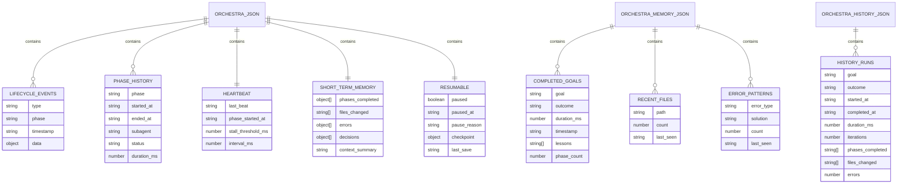
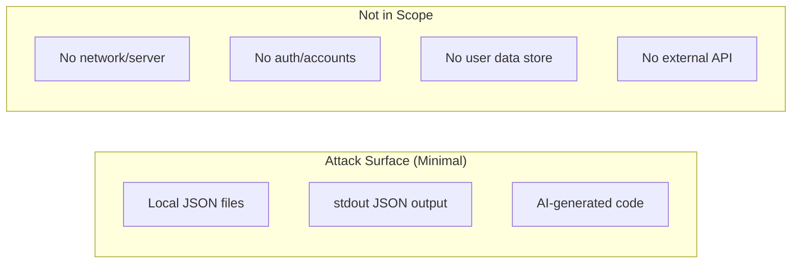

# P-Core Orchestra — Database, Security, Testing & Limitations

> **Project:** P-Core Orchestra | **Docs version:** 3.7 (October 2026) | **Docs map:** [index.md](index.md)

---

## Table of Contents

1. [Database & State](#10-database--state)
2. [Security](#11-security)
3. [Testing & Deployment](#12-testing--deployment)
4. [Known Limitations & Roadmap](#13-known-limitations--roadmap)

---

# 10. Database & State

## Overview

P-Core Orchestra has **no server database**. Persistence is local JSON state plus one **derived, rebuildable** SQLite FTS5 index (built-in `node:sqlite`) that only mirrors the goal index for faster recall — losing it costs nothing but recall sharpness:

| File | Location | Purpose | Max Size |
|------|----------|---------|----------|
| `orchestra.json` | `~/.cursor/hooks/state/` | Active orchestration state (V2) | ~2KB |
| `orchestra-memory.json` | `~/.cursor/hooks/state/` | Long-term memory | ~10KB |
| `orchestra-history.json` | `~/.cursor/hooks/state/` | Run history (auto-created) | ~20KB |
| `memory-index.json` | `~/.cursor/hooks/state/` | Inverted index over completed goals (capped at 500 entries) | ~100KB |
| `memory-fts.db` (+ `-wal`/`-shm`) | `~/.cursor/hooks/state/` | FTS5 mirror of `memory-index.json`; fused with it by reciprocal rank fusion. Best-effort: absent `node:sqlite`, an unwritable state dir, or `PCORE_FTS_DISABLE=1` leaves recall JSON-only | a few hundred KB |

OpenCode stores state at `~/.config/opencode/state/orchestra.json`.

## State Schema: `orchestra.json` (V2)

```json
{
  "version": 2,
  "ambient": true,
  "active": false,
  "goal": "",
  "phase": "idle",
  "started_at": null,
  "last_subagent": null,
  "iteration": 0,
  "max_iterations": 8,
  "last_prompt": null,
  "auto_started": null,
  "lifecycle": {
    "events": [],
    "phase_history": []
  },
  "heartbeat": {
    "last_beat": null,
    "phase_started_at": null,
    "stall_threshold_ms": 300000,
    "interval_ms": 60000
  },
  "memory": {
    "phases_completed": [],
    "files_changed": [],
    "errors": [],
    "decisions": [],
    "context_summary": ""
  },
  "resumable": {
    "paused": false,
    "paused_at": null,
    "pause_reason": null,
    "checkpoint": null,
    "last_save": null
  }
}
```

### Field Groups

| Section | Fields | Purpose |
|---------|--------|---------|
| **Top-level** | `version`, `ambient`, `active`, `goal`, `phase`, `iteration`, `max_iterations`, `started_at`, `last_subagent`, `auto_started` | Core orchestration state |
| **lifecycle** | `events[]` (200 cap), `phase_history[]` | Event log + phase timing |
| **heartbeat** | `last_beat`, `phase_started_at`, `stall_threshold_ms`, `interval_ms` | Stall detection |
| **memory** | `phases_completed[]`, `files_changed[]`, `errors[]`, `decisions[]` | Short-term (per-run) memory |
| **resumable** | `paused`, `checkpoint`, `pause_reason`, `last_save` | Pause/resume/crash recovery |

### Lifecycle Event Types

| Event | When |
|-------|------|
| `orchestra_start` | startOrchestra() called |
| `orchestra_complete` | Phase chain reaches "done" |
| `phase_advance` | Phase transition after subagent |
| `phase_complete` | Phase finished (endPhaseTimer) |
| `fix_required` | Reviewer outputs FIX_REQUIRED |
| `max_iterations` | Iteration >= max_iterations |
| `stall_detected` | Heartbeat detects stall |
| `stall_aborted` | 2nd consecutive stall |
| `subagent_complete` | Subagent status=completed |
| `subagent_error` | Subagent status!=completed |

### Checkpoint Schema (in resumable.checkpoint)

```json
{
  "phase": "implement",
  "goal": "fix login bug",
  "iteration": 2,
  "last_subagent": "orchestra-implementer",
  "started_at": "2026-07-13T14:00:00.000Z",
  "lifecycle_snapshot": [...last 20 events],
  "memory_snapshot": {...},
  "timestamp": "2026-07-13T14:05:00.000Z"
}
```

## Memory Schema: `orchestra-memory.json`

```json
{
  "version": 1,
  "completed_goals": [
    { "goal": "fix login bug", "outcome": "completed", "duration_ms": 300000,
      "timestamp": "...", "lessons": ["Use try-catch"], "phase_count": 4 }
  ],
  "project_patterns": {},
  "recent_files": [
    { "path": "src/auth/login.ts", "count": 3, "last_seen": "..." }
  ],
  "error_patterns": [
    { "error_type": "TypeScript compilation error...", "count": 3, "last_seen": "..." }
  ],
  "user_preferences": {}
}
```

**Caps:** 100 goals, 50 files, 50 errors (oldest evicted on save).

## History Schema: `orchestra-history.json`

```json
[{
  "goal": "fix login bug",
  "outcome": "completed",
  "started_at": "...", "completed_at": "...",
  "duration_ms": 300000,
  "iterations": 4,
  "phases_completed": ["plan","implement","verify","review"],
  "files_changed": ["src/auth/login.ts"],
  "errors": 0
}]
```

**Cap:** 50 runs (oldest evicted).

## Migration History

| Version | Date | Changes |
|---------|------|---------|
| V1 | 2026-07-12 | Initial: `version`, `ambient`, `active`, `goal`, `phase`, `started_at`, `last_subagent`, `iteration`, `max_iterations` |
| V2 | 2026-07-13 | Added `lifecycle`, `heartbeat`, `memory`, `resumable`. Deep merge handles migration transparently — no script needed. |

## ER Diagram



## Performance Notes

- `loadState()`: <1ms (~1KB JSON)
- `saveState()`: <5ms (~1KB JSON)
- All state operations are synchronous JSON reads/writes — no server database or connection
  pool. The derived FTS index opens its embedded SQLite file lazily and can be deleted at any time.
- State files safe to backup by simple file copy.

---

# 11. Security

## Security Model

**Local-only by default: no network endpoints, no authentication, no user accounts, no external API calls in the hook runtime.** The optional Studio server (localhost) and the MCP server (stdio) are opt-in and not started by hooks.



## Authentication & Authorization

**Not applicable.** No authentication system. No user accounts. No login.

Authorization is enforced at the agent level:

| Agent | Cursor | OpenCode |
|-------|--------|----------|
| Planner | `readonly: true` | `permission: { edit: deny, bash: allow }` |
| Implementer | Full access | Full access |
| Verifier | `readonly: true` | No restriction |
| Reviewer | `readonly: true` | `permission: { edit: deny, bash: allow }` |

## CSP, CSRF, XSS, SQL Injection

**Not applicable to the hook runtime.** It serves no web UI and opens no network sockets. The only SQL is parameterized FTS5 against a derived, local, rebuildable index. The optional Studio server (`server/`, localhost only) and MCP server (stdio) are opt-in.

## Validation

| Input | Validation |
|-------|------------|
| stdin JSON | Try-catch JSON.parse; empty object on failure |
| Prompt text | Min 8 chars, regex classification |
| Goal text | Truncated to 2000 chars |
| Subagent type | Looked up in PHASE_CHAIN; unknown = no-op |
| Workspace roots | Resolved to absolute, deduplicated |

## Rate Limiting

**Not applicable.** All processing is local. Hooks are serialized by Cursor. The only "rate limit" is Cursor's own hook loop limits (12 subagentStop, 5 stop).

## Secrets

**Rules (enforced by agent error-free rules):**
- Zero tolerance for secrets — no API keys, passwords, tokens in code
- Do not store secrets in `orchestra.json` or hook scripts
- The orchestra core has no secrets to manage
- LLM API keys are managed by Cursor/OpenCode, not by P-Core Orchestra

## Supply Chain Security

| Aspect | Status |
|--------|--------|
| Hook runtime dependencies | ✅ Built-in modules only (no third-party runtime deps) |
| Root optional dependency | 1 (`@modelcontextprotocol/sdk`) — loaded only by the opt-in stdio MCP server; lock file committed |
| Studio server dependencies | 2 (`express`, `ws`) in the private `server/` package; separate lock file |
| Single source of truth | ✅ `bundle/` is the only source |
| No external downloads at install | ✅ Installer copies locally |
| Git-tracked source | ✅ All code in git |

The hook runtime stays dependency-free, so a compromised npm tree cannot reach the hooks
themselves. The MCP SDK is required only when the optional stdio MCP server runs, and the
`express`/`ws` pair only when the optional Studio server runs.

## Security Recommendations

| Priority | Recommendation |
|----------|---------------|
| High | Never store API keys in state JSON files |
| High | Review AI-generated code for secrets before committing |
| Medium | Keep Node.js updated (18+; 22.5+ enables SQLite FTS hybrid recall) |
| Medium | Review install scripts before running |
| Low | Consider `chmod 600` on state directory on shared machines |

---

# 12. Testing & Deployment

## Testing

Validation runs at three levels: CI suites on every PR, the installed health check, and the
verifier agent inside an orchestra run.

### CI suites (`.github/workflows/ci.yml`)

37 Node suites (`scripts/test-*.js`) plus one bash suite (`scripts/test-studio-service.sh`)
run on every pull request. The `lint` job additionally runs `node --check` over every
JavaScript file, `shellcheck --severity=error`, and the blocking secret scan.

| Area | Suites |
|------|--------|
| State + safety | `test-safe-write`, `test-state-manager-compat`, `test-conductor-state`, `test-phase-outcome` |
| Agent contracts | `test-agent-registry`, `test-handshake-contract`, `test-mirror-sync`, `test-qoder-sync`, `test-merge-qoder-settings` |
| Core loop | `test-adaptive-loop`, `test-permission-review`, `test-opencode-v2`, `test-opencode-permission-contract`, `test-handoff-enforcer`, `test-sixfile-validation` |
| Enterprise domain | `test-domain-model`, `test-domain-completion`, `test-domain-store`, `test-domain-evidence`, `test-domain-state-dir`, `test-evidence-runner`, `test-review-queue`, `test-review-queue-producer` |
| Memory | `test-memory-retrieval`, `test-memory-hybrid`, `test-memory-patterns` |
| Orchestration | `test-worktree-isolation`, `test-spawn-adapter`, `test-spawn-adapter-integration`, `test-parallel-execution`, `test-mcp-server`, `test-mcp-lifecycle` |
| Studio | `test-studio-data-layer`, `test-studio-ui`, `test-studio-server`, `test-studio-integration`, `test-studio-service.sh` |
| Security | `test-security-scanner` (heuristic rules + allowlist integrity) |

`test-mirror-sync` enforces the byte-identical invariant between `bundle/hooks/` and
`bundle/opencode/hooks/`; `sync-qoder-agents.js --check` fails the build when Qoder agents
drift from the Cursor source.

### Health check (installed bundle)

`orchestra-health.js` validates 10 categories against the installed tree:

| # | Category | What It Checks |
|---|----------|----------------|
| 1 | Scripts | All 10 hook entry points exist |
| 2 | Lib modules | 33 core modules present |
| 3 | hooks.json | Valid JSON; lifecycle, memory, heartbeat, quality-gate hooks wired |
| 4 | State | V2 sections present (state, project, versioning, quality gates, heartbeat, lifecycle, memory, resumable) |
| 5 | Memory | `orchestra-memory.json` exists and parses |
| 6 | Classification | 6 prompts classified as expected |
| 7 | Agents | 27 required agent files exist |
| 8 | Enterprise state files | project / version / daily / metrics files present or initialized |
| 9 | Project identity | `templates/project.yaml` loads and validates |
| 10 | Adaptive install | No nested `hooks/lib/lib`; core loop starts at `plan`; informal prompts route to core |

It also checks session claims when the source repo is locatable.

### Classification Test Samples

```javascript
["fix import error", true],
["what is asyncio", false],
["what is the best way to fix login", true],
["explain how hooks work", false],
["deploy to VPS", true],
["no orchestra just explain", false]
```

### Running Health Checks

```bash
node ~/.cursor/hooks/orchestra-health.js
node ~/.config/opencode/hooks/orchestra-health-opencode.js
node bundle/hooks/orchestra-health.js       # pre-install
```

### Verifier Agent Checks (per orchestration)

In order: lint → typecheck → unit tests → build → `git status --porcelain` (phase commit
gate) → diff review → import check.

### Known Test Gaps

| Area | Impact | Mitigation |
|------|--------|------------|
| Install scripts | Medium — no cross-platform CI | `bash install.sh --dry-run` smoke locally; installers are thin copy/merge wrappers |
| Shell scripts (style) | Low — warnings only | `shellcheck --severity=error` is blocking; warning backlog tracked separately |
| Live host integration | Medium — Cursor, OpenCode, Qoder hook firing is manual | Handshake-contract and permission-contract suites pin the config surface |
| Multi-session concurrency | Medium — cross-session races | Worktree-isolation suite covers the isolation contract; live multi-session runs are manual |
| Studio browser E2E | Low — UI tested through modules, not a browser | `test-studio-ui` imports the real TS modules in Node 24 |

## Deployment

P-Core Orchestra has **no deployment pipeline.** Installation is the deployment:

```bash
bash install.sh                    # Cursor + OpenCode (default)
bash install.sh --cursor           # Cursor only
bash install.sh --opencode         # OpenCode only
bash install.sh --project          # + project bridge in cwd
powershell -ExecutionPolicy Bypass -File install.ps1  # Windows
```

### What Install Does

1. Creates directories under `~/.cursor/` and/or `~/.config/opencode/`
2. Copies hook scripts, lib modules, agent files, rules, skills via `cp`/`robocopy`
3. Merges `hooks.json` with existing (deduplicates by command name via embedded Node.js snippet)
4. Creates symlink at `~/.agents/skills/orchestra-loop` for external discovery
5. Preserves existing state files (doesn't overwrite)
6. Runs health checks

### Rollback

```bash
git checkout -- bundle/    # revert source
bash install.sh            # reinstall
```

### Versioning

`package.json` is the version source of truth (`version: 3.7.0`, `engines.node: >=18`).
Docs 01–04 carry a matching "Docs version" stamp. No git tags are published yet.

---

# 13. Known Limitations & Roadmap

> Status snapshot **2026-10-26 (v3.7.0)**. Point-in-time audit findings live in
> [`docs/audit/`](audit/) with their closure status; the living invariants are in
> [`context/architecture.md`](../context/architecture.md).

## Known Limitations

### Technical Debt

| # | Debt | Impact | Fix Effort |
|---|------|--------|------------|
| 1 | Shellcheck warnings (CI blocks only `--severity=error`) | Low | Medium |
| 2 | No hard per-phase timeout — stall detection only | Medium | Medium |
| 3 | Prompt-classifier regexes are heuristic (edge cases) | Medium | Low |
| 4 | No logging framework — hooks emit JSON on stdout and fail open | Low | Medium |
| 5 | Hybrid recall needs Node 22.5+ (`node:sqlite`); older Node gets JSON-only recall | Low | Documented fallback |
| 6 | Concurrent runs rely on session claims + worktree isolation; without them the shared state file can interleave writes | Medium | Medium |

### Known Bugs

None known at v3.7.0.

### Missing Features

| # | Feature | Priority | Notes |
|---|---------|----------|-------|
| 1 | Codebase RAG index | P2 | Memory recall covers completed goals, not source code |
| 2 | Durable skill state | P2 | No `skill_state` section in `orchestra.json` yet |
| 3 | Per-phase model tier | P2 | Blocked on host APIs exposing per-subagent model selection |
| 4 | Background agents | P2 | Not started |
| 5 | MVP mode (skip reviewer) | P3 | Not started |
| 6 | P-Core CLI integration | P3 | Not started |

Shipped since this list was first written: git worktree branch isolation (invariant 30), the `context/specs/` template, and SQLite FTS hybrid recall.

### Scalability Limits

| Limit | Current value | Notes |
|-------|---------------|-------|
| Concurrent orchestration runs | Session-scoped | Per-session state + `.pcore/session-claims.json`; worktree isolation gives each run its own `.pcore/state/` |
| Long-term memory (episodic) | 100 goals / 50 files / 50 errors | Ring caps in `constants.js` |
| Recall index | 500 goals (JSON) + FTS mirror | `memory-index.js` prunes oldest first and deletes the same ids from FTS |
| Lifecycle events | 200 | Ring buffer |
| History | 50 runs (100 for token history) | `constants.js` |
| Phase duration | Unlimited | Stall detection only; no hard timeout |
| Token budget | 63k per cycle | Per-agent limits |

All caps are intentional to keep state small and operations fast, and are configurable in `constants.js`.

## Architecture Decisions Log

| # | Decision | Rationale |
|---|----------|-----------|
| AD-01 | V2 state with deep merge | Backward compat without migration |
| AD-02 | Lifecycle capped at 200 | Prevent unbounded growth |
| AD-03 | Memory capped at 100/50/50 | Keep operations fast |
| AD-04 | Stall threshold 5 min | Balance false positives vs detection |
| AD-05 | Auto-abort after 2 stalls | One recovery chance, then abort |
| AD-06 | Crash recovery via stale heartbeat | Self-healing, no external process |
| AD-07 | Prompt Chaining + ReAct | Simplest correct architecture |
| AD-08 | Flat agent structure | Each agent has one clear job |
| AD-09 | Only implementer commits | Clear responsibility, audit trail |
| AD-10 | SOLID with 43 lib modules | SRP, testability, maintainability |
| AD-11 | Config-driven extensibility | Add phases/commands without logic changes |
| AD-12 | Zero npm dependencies in the hook runtime | Security, reliability, portability; the optional MCP server is the sole npm consumer |
| AD-13 | JSON persistence + one derived SQLite FTS index | Simple, backup-friendly state; the FTS mirror is rebuildable and never authoritative |

## Future Roadmap

No version numbers are promised here — items ship when they are verified.

- **Codebase RAG index** — optional `scripts/index-context.js` feeding an FTS table over `context/` and key paths.
- **Durable skill state** — `skill_state` persisted across runs; skills declare persistent fields in frontmatter.
- **Per-phase model tier** — assign cheaper models to planning/review once hosts expose per-subagent model selection.
- **Background agents** — background verifier/test runner feeding evidence while the loop continues.
- **MVP mode** — plan → implement → verify → done, skipping reviewer for fast iterations.
- **P-Core CLI** — unified `pcore orchestra install|status|history` entry point.
