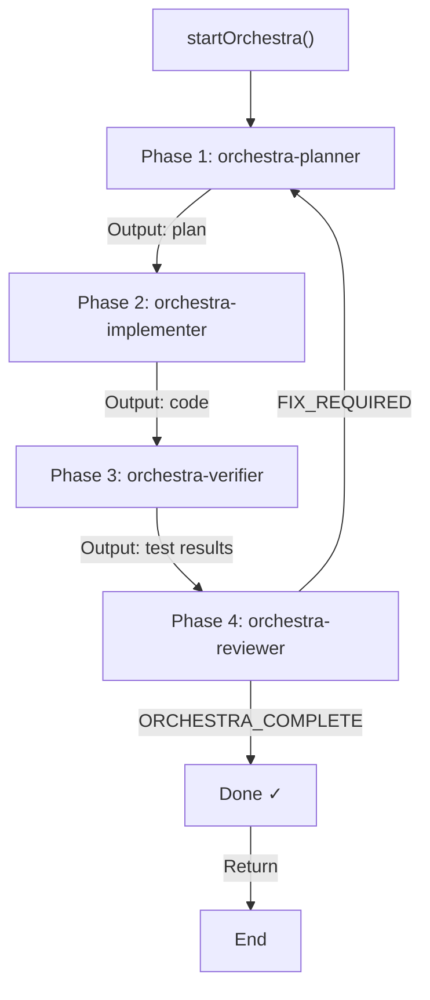
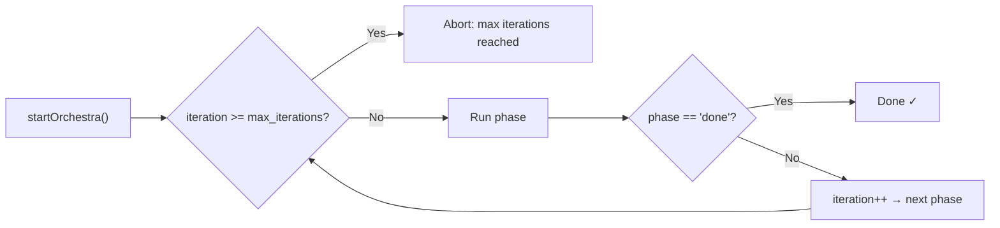
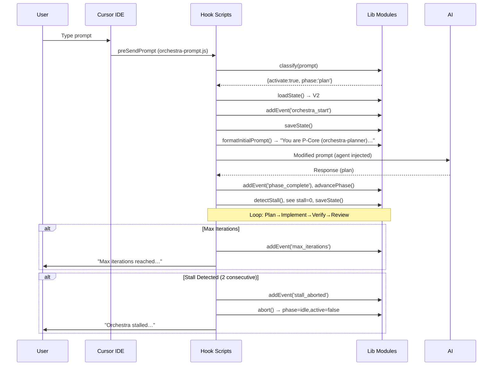

# P-Core Orchestra — AI Context, Onboarding & Statistics

> **Project:** P-Core Orchestra | **Docs version:** 3.7 (October 2026) | **Docs map:** [index.md](index.md)

---

## Table of Contents

1. [AI Context Export](#14-ai-context-export)
2. [Onboarding Guide](#15-onboarding-guide)
3. [Project Statistics](#16-project-statistics)
4. [Index](#17-index)

---

# 14. AI Context Export

This section is designed to be read directly by AI agents (Cursor, OpenCode CLI, Qoder CLI) to quickly understand the P-Core Orchestra codebase. Every lib module, hook, agent, constant, and state schema is covered in machine-readable form.

## Quick-Reference Index

| When AI is asked to… | Read this section |
|----------------------|-------------------|
| understand how hooks work | [Lifecycle Hooks](#lifecycle-hooks) |
| add/modify an agent | [Agents](#agents) |
| modify state schema | [State Schema](#state-schema) |
| understand phase flow | [Phase Chain](#phase-chain) |
| classify a prompt | [Classification Rules](#classification-rules) |
| find where config lives | [Constants](#constants) |
| find where lib modules are | [Lib Modules](#lib-modules) |
| understand startup flow | [Startup Sequence](#startup-sequence) |

## Codebase Structure

```
./
├── bundle/
│   ├── hooks/            # 11 hook entry points + lib/ (44 flat modules + 8-module domain/)
│   ├── opencode/         # OpenCode mirror: hooks/ (byte-identical lib), agents/, skills/, config
│   ├── qoder/agents/     # Qoder agent markdown, generated from the Cursor agents
│   ├── agents/           # 160 agent definitions in 37 category dirs + references/
│   ├── skills/           # Vendored + orchestra skills (Cursor)
│   ├── skills-cursor/    # Cursor built-in skill mirrors
│   ├── rules/            # Always-on .mdc rules
│   ├── config/           # autonomy + OpenCode config templates
│   ├── agent-registry.json  # Generated SSOT (v2): agents, hook agents, capabilities, task allowlist
│   └── hooks.json        # Hook wiring
├── templates/
│   ├── context/          # Blank six-file context templates
│   └── AGENTS.md         # Entry-point template
├── scripts/              # 56 JS (51 top-level + 5 lib/) + 17 shell: suites, automation, service managers
├── server/               # Studio API (Node)
├── studio/               # Read-only React/Vite dashboard
├── docs/                 # 01–04 core docs, topic guides, dated audit/ + plans/
├── context/              # This project's own six-file context
├── install.sh            # macOS/Linux installer (Cursor + OpenCode + Qoder)
└── install.ps1           # Windows PowerShell installer
```

## Lib Modules (`bundle/hooks/lib/`)

44 flat modules (plus the 8-module `domain/` package), all `"use strict"` CommonJS. The living module list and invariants are
in [`context/architecture.md`](../context/architecture.md); the table below is the
orientation map.

| Area | Modules |
|------|---------|
| State & sessions | `state-manager.js`, `checkpoint-manager.js`, `conductor-state.js`, `workspace-identity.js`, `safe-write.js` (atomic writes, locking, quarantine) |
| Memory & recall | `memory-manager.js`, `memory-index.js`, `memory-fts.js`, `semantic-memory.js` |
| Phases & gates | `phase-engine.js`, `phase-outcome.js`, `phase-commit-gate.js`, `quality-gate.js`, `plan-artifact.js`, `handoff-enforcer.js` |
| Evidence & verification | `evidence-runner.js`, `evidence-record.js`, `security-scanner.js` |
| Prompts & routing | `prompt-classifier.js`, `orchestra-config.js`, `orchestra-spawn-matrix.js`, `spawn-adapter.js` |
| Planning & delivery | `project-manager.js`, `version-manager.js`, `daily-planner.js`, `cycle-report.js`, `devops.js` |
| Greenfield & patterns | `greenfield-intake.js`, `greenfield-scaffold.js`, `self-improvement.js` |
| Ops & observability | `token-tracker.js`, `metrics-report.js`, `observability.js`, `harness-observability.js`, `heartbeat-monitor.js`, `history-recorder.js`, `lifecycle-recorder.js`, `worktree-manager.js` |
| Integrations | `mcp-server.js`, `project-identity.js`, `context-detector.js`, `io.js`, `constants.js` |

### Common API shapes

```javascript
// state-manager.js — orchestration state (root + per-session)
const state = loadState();               // → { version: 2, sessions: {...}, ... }
saveState(next);                         // atomic write
updateState((s) => next);                // read-modify-write under a lock
startOrchestra(state, { goal, phase });  // begin a loop

// memory-manager.js — short/long-term memory
flushShortToLong(state);                 // at completion/abort/max-iterations
buildMemoryContext(state);               // → string injected into agent context
buildPatternContext(state);              // → learned project/user patterns

// memory-index.js + memory-fts.js — hybrid recall
indexCompletedGoal(goalEntry, ts);       // writes JSON index + FTS mirror
searchMemoryIndex(query, topK);          // → [{ ..., score, sources: ["json"|"fts"] }]
ftsAvailable();                          // false when node:sqlite is absent or PCORE_FTS_DISABLE=1

// prompt-classifier.js — ambient classification
const { activate, phase, reason, confidence } = classifyPrompt(prompt, { ambient });
const route = selectRoute(action, projectType);   // specialists to insert

// phase-engine.js — phase chain
const phases = getPhasesForState(state); // core or enterprise SDLC chain
const next = getNextPhase(state, id);    // → next phase or null
```

### Core constants (`constants.js`)

```javascript
LIFECYCLE_MAX_EVENTS = 200        MEMORY_MAX_COMPLETED = 100
MEMORY_MAX_RECENT_FILES = 50      MEMORY_MAX_ERROR_PATTERNS = 50
HISTORY_MAX_RUNS = 50             DEFAULT_MAX_ITERATIONS = 8
DEFAULT_STALL_THRESHOLD_MS = 300000   DEFAULT_HEARTBEAT_INTERVAL_MS = 60000
SEMANTIC_RECALL_TOP_K = 3         STALL_ATTEMPTS_ABORT_THRESHOLD = 2
LOOP_MODE_CORE = "core"           LOOP_MODE_ENTERPRISE = "enterprise"
```

## Phase Chain



### Iteration Control



## Classification Rules

```javascript
// prompt-classifier.js — Regex rules (ordered by priority):
rules = [
  // BUILD prompt — e.g., "add login", "build dashboard", "create api", "new feature", "implement search", "refactor module"
  { pattern: /^(?:add|build|create|implement|setup|new|make|develop|construct|design|refactor|restructure|reorganize)\b/i, activate: true, phase: 'plan', rule: 'build_rule' },
  // FIX prompt — e.g., "fix bug", "repair auth", "correct error", "debug crash"
  { pattern: /^(?:fix|repair|patch|correct|resolve|debug)\b/i, activate: true, phase: 'plan', rule: 'fix_rule' },
  // INSTALL prompt — e.g., "install package", "set up redis", "initialize project", "configure database"
  { pattern: /^(?:install|setup|configure|initialize|bootstrap)\b/i, activate: true, phase: 'plan', rule: 'initial' },
  // DEPLOY prompt — e.g., "deploy to vercel", "publish site", "release version", "push live"
  { pattern: /^(?:deploy|publish|release|ship|launch)\b/i, activate: true, phase: 'plan', rule: 'deploy_tool' },
  // MIGRATE prompt — e.g., "migrate database", "integration", "connect api", "add auth"
  { pattern: /^(?:migrate|integrate|connect|link)\b/i, activate: true, phase: 'plan', rule: 'integrate' },
  // SCREENSHOT prompt — screenshot attached, always activate
  { pattern: /^(?:add|build|fix|create|implement|refactor)\b.*(?:ui|frontend|screen|page|component|layout|view).*[.](?:png|jpg|jpeg|gif|svg|webp)/i, activate: true, phase: 'plan', rule: 'screenshot' },
  // CONTINUE / DEBUG — start implementing immediately
  { pattern: /^(?:continue|abord|resume|keep going)\b/i, activate: true, phase: 'implement', rule: 'continue_exec' },
  { pattern: /^(?:debug|investigate|profile)\b/i, activate: true, phase: 'plan', rule: 'debug_rule' },

  // SKIP-SKIP — pure Q&A, never activate
  { pattern: /^(?:what|why|who|when|where|how|can you explain|describe|list)\b/i, activate: false, rule: 'skip_skip' },
  { pattern: /^(?:hi|hello|hey|thanks|thank you|bye|goodbye|ok|okay|sure|yes|no)\b/i, activate: false, rule: 'skip_hi' },
  // SKIP-QA — Q&A with code, activate but skip orchestration
  { pattern: /^(?:explain|tell me about|what is|how does|show me|find me|search for)\b/i, activate: false, rule: 'skip_qa' },
  // SKIP-NO-ORCHESTRA — explicit opt-out
  { pattern: /^(?:no orchestra|skip orchestra|orchestra off|manual)\b/i, activate: false, rule: 'skip_no_orch' },
]

// confidence:
//   'high'   — rule found, clear match
//   'medium' — rule found but edge case
//   'low'    — no rule matched; fallthrough to generic activate
```

## Startup Sequence



## Lifecycle Hooks

All hooks register in `hooks.json`.

### `preSendPrompt` — orchestra-prompt.js

| Aspect | Detail |
|--------|--------|
| Entry | `preSendPrompt(context)` |
| Reads | stdin JSON → `{workspacePaths, prompt, isNewSession, ...}` |
| Flow | classify → if activate: startOrchestra → inject headless agent → store phase in state → return modified JSON to context |
| Limit | 12 subagentStop, 5 stop (Cursor caps) |
| Output | Modified JSON: `{workspacePaths, prompt, isNewSession, ...}` with headless agent + task in prompt |

### `subagentStart` — orchestra-start.js

| Aspect | Detail |
|--------|--------|
| Entry | `subagentStart(context)` |
| Flow | If !active or phase=done: noop. Check iteration→max: abort. Load project context. Inject into subagent prompt. |
| Key | Loads context/*.md files and appends to subagent prompt |

### `subagentStop` — orchestra-stop.js

| Aspect | Detail |
|--------|--------|
| Entry | `subagentStop(context)` |
| Flow | Parse status, update memory, addEvent, record phase history, detect stall. Check output for ORCHESTRA_COMPLETE or FIX_REQUIRED. advancePhase. If done: saveHistory, clearCheckpoint. |

### Stop Hook (`subagentStop`) — All Known Return Values

```javascript
// User say "continue" on a FAILED plan → status: 'completed', output text
// Fix found → status: 'completed', output: ORCHESTRA_COMPLETE
// Fix needed → status: 'completed', output: FIX_REQUIRED
// User cancelled → status: 'completed', output: "I will stop the orchestra"
// Error → status: 'error'
// Timeout → status may be 'completed' or empty
```

## Agents

### orchestra-planner

```yaml
Who: Cursor Headless Agent (readonly)
Role: Research Architect
Job: Explore codebase → produce numbered implementation plan
Workspace: ~/.cursor/agents/orchestra-planner.md
Content: system prompt + six-file context + format instructions
Output: "Here is my plan: 1.… 2.… 3.…"
Limits: 32000 tokens, 1000 context files, 0 output files, 50 file matches, 3 search iterations (1000 deep)
```

### orchestra-implementer

```yaml
Who: Cursor Headless Agent (full access)
Role: Senior Software Engineer
Job: Execute plan → write code
Output: Implemented features + tests
Limits: 63000 tokens, 1000 context files, 100 output files, 100 file matches, 25 search iterations (1000 deep)
```

### orchestra-verifier

```yaml
Who: Cursor Headless Agent (readonly)
Role: QA Engineer
Job: Run commands → verify quality
Workspace: ~/.cursor/agents/orchestra-verifier.md
Checks (in order): Lint → Typecheck → Unit tests → Build → Git clean (diff) → Import check
Output: "Verification results: lint ✅, typecheck ❌ (3 errors in src/types.ts:45, 67, 89)"
Limits: 63000 tokens, 1000 context files, 0 output files, 100 file matches, 8 search iterations (256 deep)
```

### orchestra-reviewer

```yaml
Who: Cursor Headless Agent (readonly)
Role: Lead Developer
Job: Review → APPROVE/REJECT
Workspace: ~/.cursor/agents/orchestra-reviewer.md
Output: "ORCHESTRA_COMPLETE" or "FIX_REQUIRED"
Limits: 32000 tokens, 1000 context files, 0 output files, 50 file matches, 3 search iterations (256 deep)
```

## State Schema Quick Reference

```javascript
// orchestra.json (V2) — full schema:
{
  version: 2,
  ambient: true,
  active: false,           // ← set to true when orchestra runs
  goal: "",                // ← truncated to 2000 chars
  phase: "idle",           // 'plan' | 'implement' | 'verify' | 'review' | 'done' | 'idle' | 'aborted'
  started_at: null,        // ISO 8601
  last_subagent: null,      // 'orchestra-planner' | 'orchestra-implementer' | etc
  iteration: 0,
  max_iterations: 8,
  last_prompt: null,
  auto_started: null,
  lifecycle: {
    events: [],            // max 200, newest first
    phase_history: []      // append-only
  },
  heartbeat: {
    last_beat: null,       // ISO 8601
    phase_started_at: null, // ISO 8601
    stall_threshold_ms: 300000,
    interval_ms: 60000
  },
  memory: {
    phases_completed: [],  // string[] phase names
    files_changed: [],     // string[] file paths
    errors: [],            // {phase, error, timestamp}[]
    decisions: [],         // {phase, decision, timestamp}[]
    context_summary: ""
  },
  resumable: {
    paused: false,
    paused_at: null,
    pause_reason: null,
    checkpoint: null,      // full state snapshot at pause
    last_save: null        // ISO 8601
  }
}
```

---

# 15. Onboarding Guide

## For Developers

### System Requirements

| Requirement | Minimum | Recommended |
|-------------|---------|-------------|
| OS | macOS 12+, Linux, Windows 10+ | macOS 14+ |
| Node.js | 18 LTS | 20 LTS |
| Cursor IDE | 0.40+ | Latest |
| OpenCode CLI | Latest | Latest |
| Disk space | 5MB | 10MB |
| Git | 2.30+ | 2.40+ |

### Installation

```bash
# 1. Clone the repo
git clone https://github.com/P-Core-System/pcore-orchestra.git
cd pcore-orchestra

# 2. Install globally (Cursor + OpenCode + Qoder)
bash install.sh

# 3. Verify health
node ~/.cursor/hooks/orchestra-health.js

# Expected output:
# ✅ orchestra-health
# All checks passed.
```

### Project Structure Tour

```
pcore-orchestra/
├── bundle/                        # 📦 Source payload (this gets installed)
│   ├── hooks/                     # 11 hook entry points (Cursor + Qoder engine)
│   │   ├── orchestra-prompt.js    # 🔥 Entry: classifies prompts, injects agents
│   │   ├── orchestra-subagent-stop.js  # Phase advance, gates, evidence, memory flush
│   │   ├── orchestra-session-start.js  # Session context + memory recall
│   │   ├── orchestra-stop.js      # Loop nudges / completion
│   │   ├── orchestra-health.js    # Validation + health report CLI
│   │   ├── orchestra-enable.js    # Enable/disable/status/memory CLI
│   │   ├── orchestra-quality-gate.js   # Production checklist hook
│   │   └── ...                    # lifecycle, heartbeat, memory, lib
│   ├── hooks/lib/                 # 🧠 44 flat modules + 8-module domain/ (the engine)
│   │   ├── state-manager.js       # Root + per-session state
│   │   ├── memory-manager.js      # Short/long-term memory
│   │   ├── memory-index.js        # JSON inverted index (recall)
│   │   ├── memory-fts.js          # SQLite FTS5 mirror (hybrid recall)
│   │   ├── phase-engine.js        # Phase chain (core + enterprise SDLC)
│   │   ├── prompt-classifier.js   # Regex prompt classification
│   │   ├── evidence-runner.js     # Build/test/lint/security gates
│   │   ├── phase-commit-gate.js   # Commit-before-next-phase gate
│   │   └── ...                    # 35 more flat modules + domain/ (see Lib Modules above)
│   ├── agents/                    # 🎭 160 agent definitions + references/ (37 category dirs)
│   ├── qoder/agents/              # Qoder mirrors (generated)
│   ├── skills/                    # Cursor skills
│   ├── skills-cursor/             # Cursor built-in skills
│   ├── rules/                     # Cursor always-on .mdc rules
│   └── opencode/                  # OpenCode mirrors
│       ├── hooks/                 # byte-identical lib/
│       ├── agents/
│       ├── skills/
│       └── config/
├── server/                        # Studio API
├── studio/                        # React/Vite dashboard
├── docs/                          # 01–04 + topic guides + dated audit/plans
├── context/                       # Six-file project context
├── project-bridge/                # 🌉 Per-repo cursor config bridge
├── templates/                     # 📋 Context/AGENTS.md templates
├── scripts/                       # 🔧 56 JS + 17 shell
├── install.sh                     # 🚀 macOS/Linux installer
├── install.ps1                    # 🚀 Windows installer
└── README.md                      # Project docs
```

### Quick Start

```bash
# 1. Install
bash install.sh

# 2. Check health
node ~/.cursor/hooks/orchestra-health.js

# 3. Check status
node ~/.cursor/hooks/orchestra-enable.js status

# 4. Test (type in Cursor)
"add a login form component"

# 5. View state
cat ~/.cursor/hooks/state/orchestra.json

# 6. Bootstrap context in your project
bash scripts/init-context.sh ~/my-project
```

### Adding a New Hook

```javascript
// 1. Create bundle/hooks/orchestra-myhook.js
const { loadState, saveState } = require('./lib/state-manager.js');

function myHook(context) {
  const state = loadState();
  // ... your logic
  saveState(state);
}

module.exports = { myHook };

// 2. Register in bundle/hooks.json (install.sh copies it to each host)
{
  "version": 1,
  "hooks": {
    "subagentStop": [
      { "command": "node ./hooks/orchestra-myhook.js", "matcher": "orchestra-verifier" }
    ]
  }
}

// 3. Install
bash install.sh

// 4. Verify
node ~/.cursor/hooks/orchestra-health.js
```

### Code Conventions

| Convention | Rule |
|------------|------|
| Language | Node.js (no TypeScript, no transpilation) |
| Dependencies | One npm runtime dep (`@modelcontextprotocol/sdk`) for the MCP server; everything else uses Node built-ins |
| Exports | `module.exports = { functionName }` (named exports) |
| Functions | Named functions, no arrow functions for main exports |
| Variables | `const` for all; no `let` or `var` |
| Classes | No classes. Pure functions + objects only |
| Error handling | Try-catch at entry points; return fallback values |
| File I/O | `process.cwd()` for CwdContext | `~/.cursor/hooks/` for global |
| JSON | Always `JSON.stringify(obj, null, 2)` with validation |

### Testing During Development

```bash
# Quick test (standalone):
node -e "
const c = require('./bundle/hooks/lib/prompt-classifier.js');
console.log(c.classifyPrompt('fix login bug'));
"

# Test a full hook run:
echo '{"workspacePaths":["."],"prompt":"fix login bug","isNewSession":true}' | node bundle/hooks/orchestra-prompt.js

# Validate JSON:
node -e "JSON.parse(require('fs').readFileSync('bundle/hooks.json','utf8'))"

# Health check on bundle:
node bundle/hooks/orchestra-health.js
```

### Troubleshooting

| Symptom | Likely Cause | Fix |
|---------|-------------|-----|
| Orchestra doesn't start | Classification didn't match | Check prompt matches a build/fix keyword |
| Phase stuck on "plan" | Cursor subagentStart caps (12) | Restart Cursor |
| State file corruption | Concurrent writes | Use serialized hooks (Cursor serializes) |
| Hook not running | hooks.json not registered | Check install, verify hooks.json |
| "Module not found" | Install corrupt | Re-run `bash install.sh` |
| Stall warning | Long-running subagent | Normal; wait or check Cursor thread |
| Memory not working | orchestra-memory.json missing | Created automatically on first save |
| Health check fails | Missing files | Run `bash install.sh` to reinstall |

### Performance Tips

- **Avoid long prompts**: Key classification works best with 8-50 chars
- **Use explicit keywords**: "build", "fix", "add", "refactor" get highest confidence
- **Explicit opt-out**: Start with "no orchestra" to bypass
- **One goal at a time**: Let one orchestration complete before starting another
- **Context files**: Keep `context/*.md` files under 5KB each for fast loading
- **State cleanup**: Delete `~/.cursor/hooks/state/` to reset (orphans old runs)

---

# 16. Project Statistics

> Snapshot measured **2026-10-26**, excluding `node_modules`, `dist`, and vendored
> `bundle/skills/**`. Re-measure with `wc -l` after large changes.

## Codebase Metrics

| Scope | Lines |
|-------|-------|
| Hook runtime — `bundle/hooks/**/*.js` | ~14,000 |
| OpenCode mirror — `bundle/opencode/hooks/**/*.js` | ~14,500 |
| Tooling + suites — `scripts/**/*.js` | ~14,500 |
| Studio — `server/` + `studio/src` (JS/TS, deps excluded) | ~6,400 |
| Shell — `install.sh` + `scripts/*.sh` | ~5,700 |
| PowerShell — `install.ps1` + `scripts/*.ps1` | ~1,100 |
| Markdown — README + `context/` + `docs/` (incl. dated audit/plans) | ~13,500 |

**Tests:** 40 `scripts/test-*.js` suites plus `scripts/test-studio-service.sh` (21 checks). CI wires 38 Node suites + the bash suite alongside the agent-registry, secret-scan, and Qoder-drift gates; `test-agent-capabilities.js` (registry v2 / tool allowlists / skill metadata, with its installed-tree check skipped on a clean runner) and the `test-e2e-suite.js` fan-out runner are local gates.

## Largest `bundle/hooks/lib` modules

| Module | Lines | Key responsibility |
|--------|-------|-------------------|
| `evidence-runner.js` | 752 | Build/test/lint/security evidence gates |
| `project-identity.js` | 709 | `project.yaml` identity resolution |
| `token-tracker.js` | 705 | Token budgets, cache-hit metrics, tips |
| `mcp-server.js` | 606 | MCP server surface (run tools + knowledge tools, stdio + Streamable HTTP) |
| `state-manager.js` | 539 | State load/save/migrate (V2) |
| `project-manager.js` | 492 | Epics, milestones, stories, backlog |
| `memory-manager.js` | 484 | Short/long-term memory, hybrid recall injection |
| `security-scanner.js` | 467 | Secret/vulnerability scan rules |
| `conductor-state.js` | 389 | OpenCode conductor lifecycle |
| `version-manager.js` | 363 | Semver, changelog, release notes |
| `knowledge-tools.js` | 261 | Allowlisted docs/context read tools + share inbox + MCP tool definitions |
| **Total flat `lib/`** | **11,149** | 44 files |
| **`lib/domain/` package** | **955** | 8 files (domain model, store, evidence, completion, state dir) |

## Hook entry points

| Hook | Lines | Trigger |
|------|-------|---------|
| `orchestra-subagent-stop.js` | 719 | `subagentStop` — phase advance, gates, evidence, memory flush |
| `orchestra-health.js` | 417 | CLI — install/health report |
| `orchestra-prompt.js` | 372 | `beforeSubmitPrompt` / `preSendPrompt` |
| `orchestra-enable.js` | 267 | CLI — enable/memory recall |
| `orchestra-quality-gate.js` | 248 | Final review quality gate |
| `orchestra-heartbeat.js` | 87 | Stop — stall detection |
| `orchestra-session-start.js` | 84 | `sessionStart` |
| `orchestra-lifecycle.js` | 82 | Lifecycle events |
| `orchestra-stop.js` | 69 | `stop` |
| `orchestra-lib.js` | 45 | Shared helpers |
| `orchestra-memory.js` | 33 | Memory injection (`subagentStop`) |
| **Total hooks** | **2,423** | 11 entry points |

## Infrastructure

| System | Size | Notes |
|--------|------|-------|
| Installers | 1,159 lines (bash + PowerShell) | `install.sh` (611), `install.ps1` (548) |
| Scripts | 56 JS (51 top-level + 5 `lib/`) + 17 shell | Automation, suites, service managers, watcher, MCP knowledge server |
| Templates | 42 files | Six-file context blanks, specs, AGENTS, 29 architecture templates |
| Agents | 160 agent files, 27 hook agents | Generated SSOT: `bundle/agent-registry.json` |

## Dependencies

| Type | Count | Details |
|------|-------|---------|
| npm runtime | 1 | `@modelcontextprotocol/sdk` (MCP server) |
| Node built-ins | several | `fs`, `path`, `child_process`, `crypto`, `os`, `sqlite` (optional — FTS memory) |
| Shell commands | 3 | `git`, `curl`, `bash` |

## History

Version history is append-only in `context/progress-tracker.md`; the current semver
lives in `project.yaml` and `package.json`.

---

# 17. Index

| Section | File | Description |
|---------|------|-------------|
| 1 | `docs/01-OVERVIEW-AND-ARCHITECTURE.md` | Executive summary, tech stack, folder structure, application architecture, system architecture |
| 2 | `docs/01-OVERVIEW-AND-ARCHITECTURE.md` | Monorepo structure, bundle payload, project bridge, templates, installers |
| 3 | `docs/01-OVERVIEW-AND-ARCHITECTURE.md` | Full folder tree (every directory, every file with comments) |
| 4 | `docs/01-OVERVIEW-AND-ARCHITECTURE.md` | Application architecture — prompt chaining + ReAct, data flow, lifecycle, file naming conventions, config-driven extensibility, source of truth flow |
| 5 | `docs/01-OVERVIEW-AND-ARCHITECTURE.md` | SOLID, architectural invariants, C4 diagrams (Context, Container, Component), LLM topology, hook lifecycle, event storming |
| 6 | `docs/02-FEATURES-HOOKS-COMPONENTS-AGENTS.md` | All 16 features — ambient auto-start, build/fix, four-phase loop, stall detection, pause/resume, crash recovery, memory, history, six-file context, classification, config-driven, headless agents, dependency-free hook runtime, install/verify, project bootstrap, conductor run state |
| 7 | `docs/02-FEATURES-HOOKS-COMPONENTS-AGENTS.md` | Hook architecture, 8-command hook contract table + 3 non-event entry points, hooks.json config, event-driven flow diagram, hand-coded rules |
| 8 | `docs/02-FEATURES-HOOKS-COMPONENTS-AGENTS.md` | Hook and lib module reference for `bundle/hooks/lib/` (44 flat modules + `domain/`) |
| 9 | `docs/02-FEATURES-HOOKS-COMPONENTS-AGENTS.md` | Core loop agents — planner, implementer, verifier, reviewer — for Cursor, OpenCode, and Qoder |
| 10 | `docs/03-DATABASE-SECURITY-TESTING-LIMITATIONS.md` | State, memory, history schemas, field groups, lifecycle events, checkpoint schema, migration history, ER diagram, performance |
| 11 | `docs/03-DATABASE-SECURITY-TESTING-LIMITATIONS.md` | Security model, auth/authz, CSP/CSRF/XSS/SQLi, input validation, rate limiting, secrets, supply chain security, recommendations |
| 12 | `docs/03-DATABASE-SECURITY-TESTING-LIMITATIONS.md` | CI suite matrix, 10-category health check, verifier checks, known test gaps, deployment (install + rollback) |
| 13 | `docs/03-DATABASE-SECURITY-TESTING-LIMITATIONS.md` | Technical debt (6 items), missing features (6 items), scalability limits, architecture decisions log (13 ADs), future roadmap |
| 14 | `docs/04-AI-CONTEXT-ONBOARDING-STATISTICS.md` | AI context export — quick-reference index, codebase structure, lib module API reference, phase chain, classification rules, startup sequence, lifecycle hooks, agent definitions, state schema reference |
| 15 | `docs/04-AI-CONTEXT-ONBOARDING-STATISTICS.md` | Onboarding guide — system requirements, installation, project tour, quick start, adding a hook, code conventions, testing, troubleshooting, performance tips |
| 16 | `docs/04-AI-CONTEXT-ONBOARDING-STATISTICS.md` | Project statistics — codebase metrics, largest modules, hook entry points, infrastructure, dependencies (snapshot 2026-10-26) |
| 17 | `docs/04-AI-CONTEXT-ONBOARDING-STATISTICS.md` | This document — `docs/` index (cross-reference all sections across all 4 files) |
