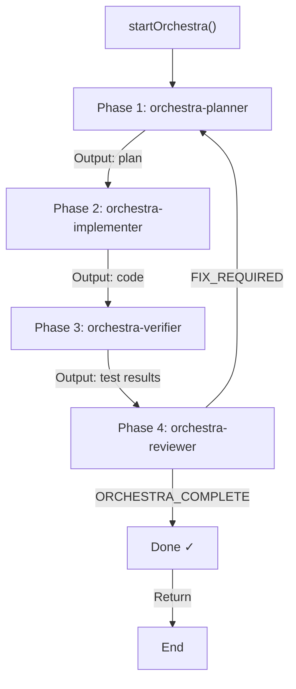
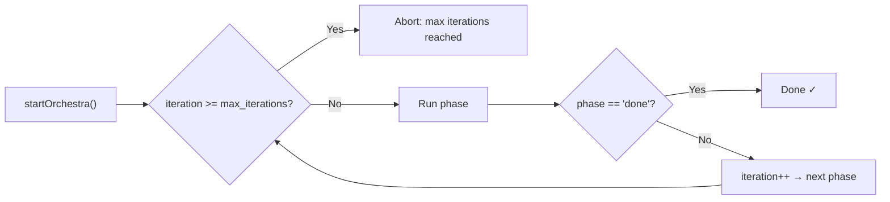
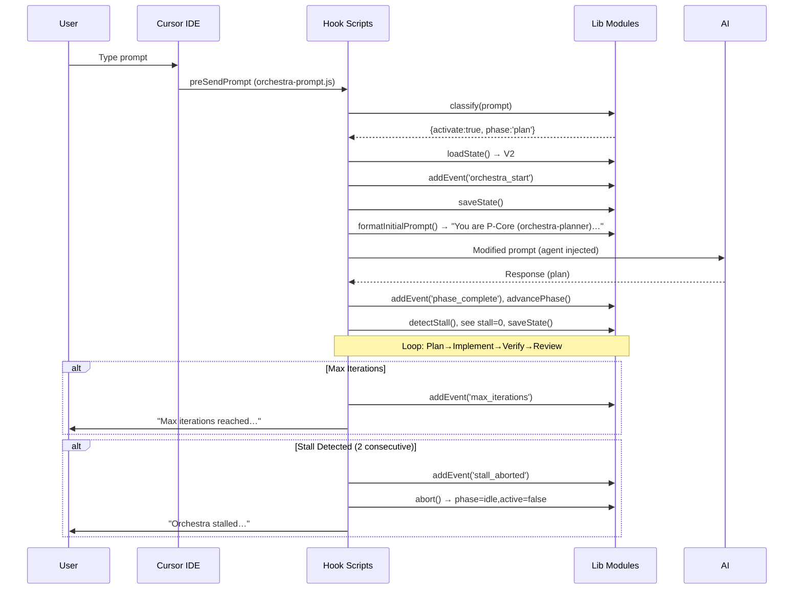
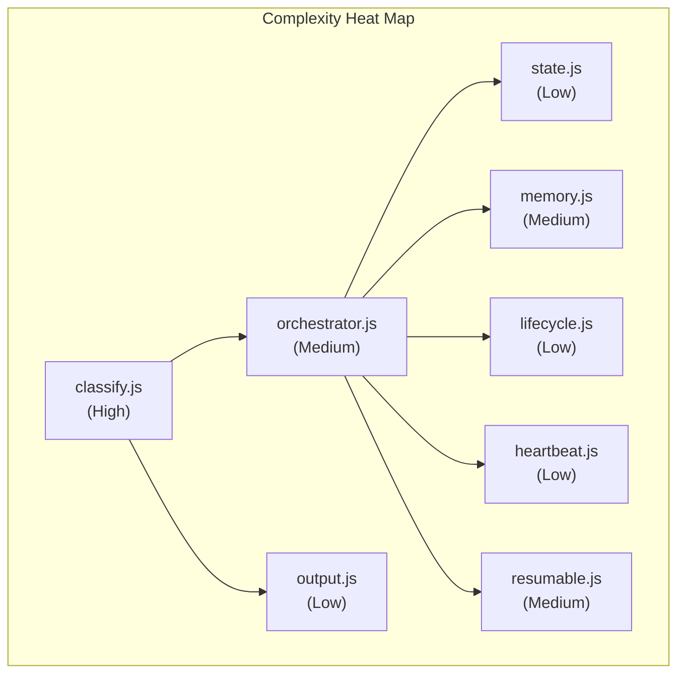

# P-Core Orchestra — AI Context, Onboarding & Statistics

---

## Table of Contents

1. [AI Context Export](#14-ai-context-export)
2. [Onboarding Guide](#15-onboarding-guide)
3. [Project Statistics](#16-project-statistics)
4. [Index](#17-index)

---

# 14. AI Context Export

This section is designed to be read directly by AI agents (Cursor, Claude, OpenCode) to quickly understand the P-Core Orchestra codebase. Every lib module, hook, agent, constant, and state schema is covered in machine-readable form.

## Quick-Reference Index

| When AI is asked to… | Read this section |
|----------------------|-------------------|
| understand how hooks work | [Lifecycle Hooks](#lifecycle-hooks) |
| add/modify an agent | [Agents](#agents) |
| modify state schema | [State Schema](#state-schema) |
| understand phase flow | [Phase Chain](#phase-chain) |
| classify a prompt | [Classification Rules](#classification-rules) |
| find where config lives | [Constants](#constants) |
| find where lib modules are | [Lib Modules](#lib-modules) |
| understand startup flow | [Startup Sequence](#startup-sequence) |

## Codebase Structure

```
./
├── bundle/
│   ├── hooks/          # 9 Node.js hook scripts (Cursor)
│   ├── agents/         # 4 Cursor subagent .md files
│   ├── skills/         # Cursor skills (orchestra-loop + Cloudflare)
│   ├── skills-cursor/  # Cursor built-in skills
│   ├── rules/          # Cursor always-on .mdc rules
│   ├── opencode/
│   │   ├── hooks/      # 1 OpenCode health check
│   │   ├── agents/     # 4 OpenCode subagent .md files
│   │   ├── skills/     # OpenCode skills (orchestra-loop + Cloudflare)
│   │   └── state/      # Default orchestra.json
│   └── lib/            # 11 shared Node.js modules (engine core)
├── templates/
│   ├── context/        # Blank six-file context templates
│   └── AGENTS.md       # Entry-point template
├── scripts/
│   └── init-context.sh # Bootstrap context in any repo
├── install.sh          # macOS/Linux installer
└── install.ps1         # Windows PowerShell installer
```

## Lib Modules (`bundle/lib/`)

All modules use `const` exports pattern. Every function returns a result object consistently.

### 1. `state.js` — State Manager
```javascript
// State file paths (auto-resolved):
// Cursor: ~/.cursor/hooks/state/orchestra.json
// OpenCode: ~/.config/opencode/state/orchestra.json

const state = loadState()          // → {version:2, ambient:true, ...}
const saved = saveState(newState)  // → {success:true}
const exists = stateExists()       // → boolean
const migrated = migrateV1(state)  // → {version:2, ...} (in-place)
```

### 2. `memory.js` — Long-term Memory
```javascript
const mem = loadMemory()          // → {version:1, completed_goals:[], ...}
const saved = saveMemory(mem)     // → {success:true}
const exists = memoryExists()     // → boolean
const updated = addGoal(opts{goal, outcome, duration_ms, lessons, phase_count})
const updated = addFile(path)     // increment count, update last_seen
const updated = addError(error_type, solution)
const summary = summarizeMemory() // → string for subagent context
const related = findRelated(goal) // → top-3 matched goals (simple substring)
```

### 3. `history.js` — Run History
```javascript
const hist = loadHistory()       // → [{goal, outcome, ...}]
const saved = saveHistory(hist)  // → {success:true}
const updated = addRun({goal, outcome, started_at, completed_at, duration_ms, iterations, phases_completed, files_changed, errors})
```

### 4. `lifecycle.js` — Lifecycle Events
```javascript
const log = addEvent(state, type, data)     // → state (event prepended, capped 200)
const log = addPhaseHistory(state, phase, status, subagent, duration_ms)  // → state
const timeline = renderTimeline(events)     // → formatted string
```

### 5. `heartbeat.js` — Stall Detection
```javascript
const state = beat(state)          // → state (update last_beat + phase_started_at)
const state = detectStall(state)   // → state (detectStall ++ or abort)
const { isStalled, stalledMs } = checkStall(state)  // → {isStalled:boolean, stalledMs:number}
```

### 6. `resumable.js` — Pause/Resume
```javascript
const state = createCheckpoint(state, phase)   // → state with checkpoint
const state = clearCheckpoint(state)           // → state, checkpoint null
const state = pause(state, reason)             // → paused:true
const state = resume(state)                    // → paused:false, restore from checkpoint
const state = abort(state)                     // → phase:'idle', active:false
```

### 7. `classify.js` — Prompt Classification
```javascript
const { activate, phase, reason, confidence, rule } = classify(prompt)  
// activate: boolean
// phase: 'plan' | 'implement' | 'verify' | 'review' | null
// confidence: 'high' | 'medium' | 'low'
// reason: 'build prompt' | 'fix prompt' | 'skip prompt' | ...
// rule: 'build_rule' | 'fix_rule' | 'skip_skip' | 'skip_qa' | ...
```

### 8. `orchestrator.js` — Phase Orchestrator
```javascript
const phase = getCurrentPhase(state)             // → 'plan' | 'implement' | ...
const subagent = getSubagentForPhase(phase)      // → agent filename
const state = advancePhase(state)                // → state (next phase or done)
const agentFullName = getAgentFullName(agentName)// → 'orchestra-planner' etc
const isDone = isOrchestraComplete(state)         // → boolean
```

### 9. `output.js` — Output Formatter
```javascript
const json = formatOutput(state, options)  // → JSON string with lifecycle,narrative
const prompt = formatInitialPrompt(state)  // → "You are P-Core Orchestra (orchestra-planner)..." with context
```

### 10. `context.js` — Six-File Context Loader
```javascript
const { files, found, missing } = loadProjectContext()  // Loads context/*.md content
```

### 11. `constants.js` — Configuration
```javascript
PHASE_CHAIN: ['plan', 'implement', 'verify', 'review']
SUBAGENTS: { plan: 'orchestra-planner', implement: 'orchestra-implementer', verify: 'orchestra-verifier', review: 'orchestra-reviewer' }
PROMPT_AGENTS: { plan: instructor, implement: builder, verify: verifier, review: reviewer }
MAX_ITERATIONS: 8
STALL_THRESHOLD_MS: 300000 (5 min)
HEARTBEAT_INTERVAL_MS: 60000 (1 min)
MAX_STALL_COUNT: 2
MAX_EVENTS: 200
MAX_MEMORY_GOALS: 100
MAX_MEMORY_FILES: 50
MAX_MEMORY_ERRORS: 50
MAX_HISTORY: 50
MIN_PROMPT_LENGTH: 8
MAX_GOAL_LENGTH: 2000
```

## Phase Chain



### Iteration Control



## Classification Rules

```javascript
// classify.js — Regex rules (ordered by priority):
rules = [
  // BUILD prompt — e.g., "add login", "build dashboard", "create api", "new feature", "implement search", "refactor module"
  { pattern: /^(?:add|build|create|implement|setup|new|make|develop|construct|design|refactor|restructure|reorganize)\b/i, activate: true, phase: 'plan', rule: 'build_rule' },
  // FIX prompt — e.g., "fix bug", "repair auth", "correct error", "debug crash"
  { pattern: /^(?:fix|repair|patch|correct|resolve|debug)\b/i, activate: true, phase: 'plan', rule: 'fix_rule' },
  // INSTALL prompt — e.g., "install package", "set up redis", "initialize project", "configure database"
  { pattern: /^(?:install|setup|configure|initialize|bootstrap)\b/i, activate: true, phase: 'plan', rule: 'initial' },
  // DEPLOY prompt — e.g., "deploy to vercel", "publish site", "release version", "push live"
  { pattern: /^(?:deploy|publish|release|ship|launch)\b/i, activate: true, phase: 'plan', rule: 'deploy_tool' },
  // MIGRATE prompt — e.g., "migrate database", "integration", "connect api", "add auth"
  { pattern: /^(?:migrate|integrate|connect|link)\b/i, activate: true, phase: 'plan', rule: 'integrate' },
  // SCREENSHOT prompt — screenshot attached, always activate
  { pattern: /^(?:add|build|fix|create|implement|refactor)\b.*(?:ui|frontend|screen|page|component|layout|view).*[.](?:png|jpg|jpeg|gif|svg|webp)/i, activate: true, phase: 'plan', rule: 'screenshot' },
  // CONTINUE / DEBUG — start implementing immediately
  { pattern: /^(?:continue|abord|resume|keep going)\b/i, activate: true, phase: 'implement', rule: 'continue_exec' },
  { pattern: /^(?:debug|investigate|profile)\b/i, activate: true, phase: 'plan', rule: 'debug_rule' },

  // SKIP-SKIP — pure Q&A, never activate
  { pattern: /^(?:what|why|who|when|where|how|can you explain|describe|list)\b/i, activate: false, rule: 'skip_skip' },
  { pattern: /^(?:hi|hello|hey|thanks|thank you|bye|goodbye|ok|okay|sure|yes|no)\b/i, activate: false, rule: 'skip_hi' },
  // SKIP-QA — Q&A with code, activate but skip orchestration
  { pattern: /^(?:explain|tell me about|what is|how does|show me|find me|search for)\b/i, activate: false, rule: 'skip_qa' },
  // SKIP-NO-ORCHESTRA — explicit opt-out
  { pattern: /^(?:no orchestra|skip orchestra|orchestra off|manual)\b/i, activate: false, rule: 'skip_no_orch' },
]

// confidence:
//   'high'   — rule found, clear match
//   'medium' — rule found but edge case
//   'low'    — no rule matched; fallthrough to generic activate
```

## Startup Sequence



## Lifecycle Hooks

All hooks register in `hooks.json`.

### `preSendPrompt` — orchestra-prompt.js

| Aspect | Detail |
|--------|--------|
| Entry | `preSendPrompt(context)` |
| Reads | stdin JSON → `{workspacePaths, prompt, isNewSession, ...}` |
| Flow | classify → if activate: startOrchestra → inject headless agent → store phase in state → return modified JSON to context |
| Limit | 12 subagentStop, 5 stop (Cursor caps) |
| Output | Modified JSON: `{workspacePaths, prompt, isNewSession, ...}` with headless agent + task in prompt |

### `subagentStart` — orchestra-start.js

| Aspect | Detail |
|--------|--------|
| Entry | `subagentStart(context)` |
| Flow | If !active or phase=done: noop. Check iteration→max: abort. Load project context. Inject into subagent prompt. |
| Key | Loads context/*.md files and appends to subagent prompt |

### `subagentStop` — orchestra-stop.js

| Aspect | Detail |
|--------|--------|
| Entry | `subagentStop(context)` |
| Flow | Parse status, update memory, addEvent, record phase history, detect stall. Check output for ORCHESTRA_COMPLETE or FIX_REQUIRED. advancePhase. If done: saveHistory, clearCheckpoint. |

### Stop Hook (`subagentStop`) — All Known Return Values

```javascript
// User say "continue" on a FAILED plan → status: 'completed', output text
// Fix found → status: 'completed', output: ORCHESTRA_COMPLETE
// Fix needed → status: 'completed', output: FIX_REQUIRED
// User cancelled → status: 'completed', output: "I will stop the orchestra"
// Error → status: 'error'
// Timeout → status may be 'completed' or empty
```

## Agents

### orchestra-planner

```yaml
Who: Cursor Headless Agent (readonly)
Role: Research Architect
Job: Explore codebase → produce numbered implementation plan
Workspace: ~/.cursor/agents/orchestra-planner.md
Content: system prompt + six-file context + format instructions
Output: "Here is my plan: 1.… 2.… 3.…"
Limits: 32000 tokens, 1000 context files, 0 output files, 50 file matches, 3 search iterations (1000 deep)
```

### orchestra-implementer

```yaml
Who: Cursor Headless Agent (full access)
Role: Senior Software Engineer
Job: Execute plan → write code
Output: Implemented features + tests
Limits: 63000 tokens, 1000 context files, 100 output files, 100 file matches, 25 search iterations (1000 deep)
```

### orchestra-verifier

```yaml
Who: Cursor Headless Agent (readonly)
Role: QA Engineer
Job: Run commands → verify quality
Workspace: ~/.cursor/agents/orchestra-verifier.md
Checks (in order): Lint → Typecheck → Unit tests → Build → Git clean (diff) → Import check
Output: "Verification results: lint ✅, typecheck ❌ (3 errors in src/types.ts:45, 67, 89)"
Limits: 63000 tokens, 1000 context files, 0 output files, 100 file matches, 8 search iterations (256 deep)
```

### orchestra-reviewer

```yaml
Who: Cursor Headless Agent (readonly)
Role: Lead Developer
Job: Review → APPROVE/REJECT
Workspace: ~/.cursor/agents/orchestra-reviewer.md
Output: "ORCHESTRA_COMPLETE" or "FIX_REQUIRED"
Limits: 32000 tokens, 1000 context files, 0 output files, 50 file matches, 3 search iterations (256 deep)
```

## State Schema Quick Reference

```javascript
// orchestra.json (V2) — full schema:
{
  version: 2,
  ambient: true,
  active: false,           // ← set to true when orchestra runs
  goal: "",                // ← truncated to 2000 chars
  phase: "idle",           // 'plan' | 'implement' | 'verify' | 'review' | 'done' | 'idle' | 'aborted'
  started_at: null,        // ISO 8601
  last_subagent: null,      // 'orchestra-planner' | 'orchestra-implementer' | etc
  iteration: 0,
  max_iterations: 8,
  last_prompt: null,
  auto_started: null,
  lifecycle: {
    events: [],            // max 200, newest first
    phase_history: []      // append-only
  },
  heartbeat: {
    last_beat: null,       // ISO 8601
    phase_started_at: null, // ISO 8601
    stall_threshold_ms: 300000,
    interval_ms: 60000
  },
  memory: {
    phases_completed: [],  // string[] phase names
    files_changed: [],     // string[] file paths
    errors: [],            // {phase, error, timestamp}[]
    decisions: [],         // {phase, decision, timestamp}[]
    context_summary: ""
  },
  resumable: {
    paused: false,
    paused_at: null,
    pause_reason: null,
    checkpoint: null,      // full state snapshot at pause
    last_save: null        // ISO 8601
  }
}
```

---

# 15. Onboarding Guide

## For Developers

### System Requirements

| Requirement | Minimum | Recommended |
|-------------|---------|-------------|
| OS | macOS 12+, Linux, Windows 10+ | macOS 14+ |
| Node.js | 18 LTS | 20 LTS |
| Cursor IDE | 0.40+ | Latest |
| OpenCode CLI | Latest | Latest |
| Disk space | 5MB | 10MB |
| Git | 2.30+ | 2.40+ |

### Installation

```bash
# 1. Clone the repo
git clone https://github.com/peterlianpi/pcore-orchestra.git
cd pcore-orchestra

# 2. Install globally (both Cursor + OpenCode)
bash install.sh

# 3. Verify health
node ~/.cursor/hooks/orchestra-health.js

# Expected output:
# ✅ orchestra-health
# All 6 checks passed.
```

### Project Structure Tour

```
pcore-orchestra/
├── bundle/                        # 📦 Source payload (this gets installed)
│   ├── hooks/                     # 9 Node.js scripts (Cursor engine)
│   │   ├── orchestra-prompt.js    # 🔥 Entry: classifies prompts, injects agents
│   │   ├── orchestra-start.js     # Injects project context into subagent
│   │   ├── orchestra-stop.js      # Phase transitions, memory, status parsing
│   │   ├── orchestra-health.js    # 6-category validation suite
│   │   ├── orchestra-enable.js    # Enable/disable/status toggles
│   │   └── ...                    # 4 more
│   ├── lib/                       # 🧠 11 shared modules (the engine)
│   │   ├── classify.js            # Regex prompt classification
│   │   ├── orchestrator.js        # Phase chain management
│   │   ├── state.js               # JSON state persistence
│   │   ├── memory.js              # Long-term learning
│   │   ├── history.js             # Run history
│   │   ├── lifecycle.js           # Event logging
│   │   ├── heartbeat.js           # Stall detection
│   │   ├── resumable.js           # Pause/resume/crash recovery
│   │   ├── context.js             # Six-file context loader
│   │   ├── output.js              # Prompt formatters
│   │   └── constants.js           # All configuration values
│   ├── agents/                    # 🎭 4 Cursor agent definitions
│   ├── skills/                    # Cursor skills
│   ├── skills-cursor/             # Cursor built-in skills
│   ├── rules/                     # Cursor always-on .mdc rules
│   └── opencode/                  # OpenCode mirrors
│       ├── hooks/
│       ├── agents/
│       ├── skills/
│       └── state/
├── project-bridge/                # 🌉 Per-repo cursor config bridge
├── templates/                     # 📋 Context/AGENTS.md templates
├── scripts/                       # 🔧 init-context bootstrap
├── install.sh                     # 🚀 macOS/Linux installer
├── install.ps1                    # 🚀 Windows installer
└── README.md                      # Project docs
```

### Quick Start

```bash
# 1. Install
bash install.sh

# 2. Check health
node ~/.cursor/hooks/orchestra-health.js

# 3. Check status
node ~/.cursor/hooks/orchestra-enable.js status

# 4. Test (type in Cursor)
"add a login form component"

# 5. View state
cat ~/.cursor/hooks/state/orchestra.json

# 6. Bootstrap context in your project
bash scripts/init-context.sh ~/my-project
```

### Adding a New Hook

```javascript
// 1. Create bundle/hooks/orchestra-myhook.js
const { loadState, saveState } = require('./lib/state.js');

function myHook(context) {
  const state = loadState();
  // ... your logic
  saveState(state);
}

module.exports = { myHook };

// 2. Register in bundle/hooks/hooks.json
{
  "myHook": "hooks/orchestra-myhook.js"
}

// 3. Install
bash install.sh

// 4. Verify
node ~/.cursor/hooks/orchestra-health.js
```

### Code Conventions

| Convention | Rule |
|------------|------|
| Language | Node.js (no TypeScript, no transpilation) |
| Dependencies | Zero npm dependencies; built-in modules only (fs, path, child_process) |
| Exports | `module.exports = { functionName }` (named exports) |
| Functions | Named functions, no arrow functions for main exports |
| Variables | `const` for all; no `let` or `var` |
| Classes | No classes. Pure functions + objects only |
| Error handling | Try-catch at entry points; return fallback values |
| File I/O | `process.cwd()` for CwdContext | `~/.cursor/hooks/` for global |
| JSON | Always `JSON.stringify(obj, null, 2)` with validation |

### Testing During Development

```bash
# Quick test (standalone):
node -e "
const c = require('./bundle/lib/classify.js');
console.log(c.classify('fix login bug'));
"

# Test a full hook run:
echo '{"workspacePaths":["."],"prompt":"fix login bug","isNewSession":true}' | node bundle/hooks/orchestra-prompt.js

# Validate JSON:
node -e "JSON.parse(require('fs').readFileSync('bundle/hooks/hooks.json','utf8'))"

# Health check on bundle:
node bundle/hooks/orchestra-health.js
```

### Troubleshooting

| Symptom | Likely Cause | Fix |
|---------|-------------|-----|
| Orchestra doesn't start | Classification didn't match | Check prompt matches a build/fix keyword |
| Phase stuck on "plan" | Cursor subagentStart caps (12) | Restart Cursor |
| State file corruption | Concurrent writes | Use serialized hooks (Cursor serializes) |
| Hook not running | hooks.json not registered | Check install, verify hooks.json |
| "Module not found" | Install corrupt | Re-run `bash install.sh` |
| Stall warning | Long-running subagent | Normal; wait or check Cursor thread |
| Memory not working | orchestra-memory.json missing | Created automatically on first save |
| Health check fails | Missing files | Run `bash install.sh` to reinstall |

### Performance Tips

- **Avoid long prompts**: Key classification works best with 8-50 chars
- **Use explicit keywords**: "build", "fix", "add", "refactor" get highest confidence
- **Explicit opt-out**: Start with "no orchestra" to bypass
- **One goal at a time**: Let one orchestration complete before starting another
- **Context files**: Keep `context/*.md` files under 5KB each for fast loading
- **State cleanup**: Delete `~/.cursor/hooks/state/` to reset (orphans old runs)

---

# 16. Project Statistics

## Codebase Metrics

| Metric | Value |
|--------|-------|
| Total files | 120+ |
| Lines of code (JS) | ~5,500 |
| Lines of code (Markdown) | ~1,200 |
| Lines of code (Shell) | ~200 |
| Lines of code (PowerShell) | ~100 |
| Lines of code (JSON) | ~50 |
| **Total** | **~7,050** |

## Module Metrics

| Module | Lines (approx) | Functions | Key Responsibility |
|--------|---------------|-----------|-------------------|
| `state.js` | 80 | 4 | JSON state load/save/migrate |
| `memory.js` | 120 | 7 | Long-term memory CRUD |
| `history.js` | 60 | 3 | Run history |
| `lifecycle.js` | 60 | 3 | Event logging |
| `heartbeat.js` | 50 | 3 | Stall detection |
| `resumable.js` | 60 | 4 | Pause/resume/abort |
| `classify.js` | 80 | 1 | Prompt classification |
| `orchestrator.js` | 50 | 5 | Phase chain |
| `output.js` | 50 | 2 | Formatting |
| `context.js` | 40 | 1 | Context loading |
| `constants.js` | 25 | - | Configuration |
| **Total lib** | **~675** | **33** | |

## Hook Metrics

| Hook | Lines (approx) | Entry Point | Complexity |
|------|---------------|-------------|------------|
| `orchestra-prompt.js` | 120 | `preSendPrompt` | High |
| `orchestra-start.js` | 60 | `subagentStart` | Medium |
| `orchestra-stop.js` | 140 | `subagentStop` | High |
| `orchestra-health.js` | 80 | `_` | Low |
| `orchestra-enable.js` | 40 | `_` | Low |
| `orchestra-memory.js` | 60 | `subagentStart`/`Stop` | Low |
| `orchestra-session.js` | 80 | `preSendPrompt` | Low |
| `orchestra-prompt-hooks.js` | 40 | hooks.json merge | Low |
| `orchestra-heartbeat.js` | 60 | `subagentStop` | Low |

## Infrastructure

| System | Files | Lines | Notes |
|--------|-------|-------|-------|
| Installers | 2 | ~250 | bash + PowerShell |
| Scripts | 1 | ~100 | init-context.sh |
| Templates | ~12 | ~400 | context templates + AGENTS.md |
| Project bridge | ~5 | ~50 | .cursorrules + symlinks |
| **Total infra** | **~20** | **~800** | |

## Dependencies

| Type | Count | Details |
|------|-------|---------|
| npm packages | 0 | Zero dependencies |
| Built-in Node.js modules | 3 | `fs`, `path`, `child_process` |
| Shell commands | 2 | `curl` (health check), `git` (init-context) |

## Complexity



## Version History

| Version | Date | Key Changes |
|---------|------|-------------|
| 1.0.0 | 2026-07-13 | Initial release: V2 state, all 4 agents, health check, classification, stall detection, pause/resume, memory, history, zero npm deps |

---

# 17. Index

| Section | File | Description |
|---------|------|-------------|
| 1 | `docs/01-OVERVIEW-AND-ARCHITECTURE.md` | Executive summary, tech stack, folder structure, application architecture, system architecture |
| 2 | `docs/01-OVERVIEW-AND-ARCHITECTURE.md` | Monorepo structure, bundle payload, project bridge, templates, installers |
| 3 | `docs/01-OVERVIEW-AND-ARCHITECTURE.md` | Full folder tree (every directory, every file with comments) |
| 4 | `docs/01-OVERVIEW-AND-ARCHITECTURE.md` | Application architecture — prompt chaining + ReAct, data flow, lifecycle, file naming conventions, config-driven extensibility, source of truth flow |
| 5 | `docs/01-OVERVIEW-AND-ARCHITECTURE.md` | SOLID, architectural invariants, C4 diagrams (Context, Container, Component), LLM topology, hook lifecycle, event storming |
| 6 | `docs/02-FEATURES-HOOKS-COMPONENTS-AGENTS.md` | All 15 features — ambient auto-start, build/fix, four-phase loop, stall detection, pause/resume, crash recovery, memory, history, six-file context, classification, config-driven, headless agents, zero npm, install/verify, project bootstrap |
| 7 | `docs/02-FEATURES-HOOKS-COMPONENTS-AGENTS.md` | Hook architecture, 9 hook contract table (entry, purpose, complexity, limits), hooks.json config, event-driven flow diagram, hand-coded rules |
| 8 | `docs/02-FEATURES-HOOKS-COMPONENTS-AGENTS.md` | All 11 lib modules — state.js, memory.js, history.js, lifecycle.js, heartbeat.js, resumable.js, classify.js, orchestrator.js, output.js, context.js, constants.js |
| 9 | `docs/02-FEATURES-HOOKS-COMPONENTS-AGENTS.md` | All 8 agents (4 Cursor + 4 OpenCode) — planner, implementer, verifier, reviewer agent definitions |
| 10 | `docs/03-DATABASE-SECURITY-TESTING-LIMITATIONS.md` | State, memory, history schemas, field groups, lifecycle events, checkpoint schema, migration history, ER diagram, performance |
| 11 | `docs/03-DATABASE-SECURITY-TESTING-LIMITATIONS.md` | Security model, auth/authz, CSP/CSRF/XSS/SQLi, input validation, rate limiting, secrets, supply chain security, recommendations |
| 12 | `docs/03-DATABASE-SECURITY-TESTING-LIMITATIONS.md` | Health check tests (6 categories), verifier checks, Turnstile-Spin tests, missing tests, deployment (install + rollback) |
| 13 | `docs/03-DATABASE-SECURITY-TESTING-LIMITATIONS.md` | Technical debt (5 items), missing features (7 items), scalability limits, architecture decisions log (13 ADs), future roadmap (P1-P3) |
| 14 | `docs/04-AI-CONTEXT-ONBOARDING-STATISTICS.md` | AI context export — quick-reference index, codebase structure, lib module API reference, phase chain, classification rules, startup sequence, lifecycle hooks, agent definitions, state schema reference |
| 15 | `docs/04-AI-CONTEXT-ONBOARDING-STATISTICS.md` | Onboarding guide — system requirements, installation, project tour, quick start, adding a hook, code conventions, testing, troubleshooting, performance tips |
| 16 | `docs/04-AI-CONTEXT-ONBOARDING-STATISTICS.md` | Project statistics — codebase metrics, module metrics, hook metrics, infrastructure, dependencies, complexity heat map, version history |
| 17 | `docs/04-AI-CONTEXT-ONBOARDING-STATISTICS.md` | This document — `docs/` index (cross-reference all sections across all 4 files) |
