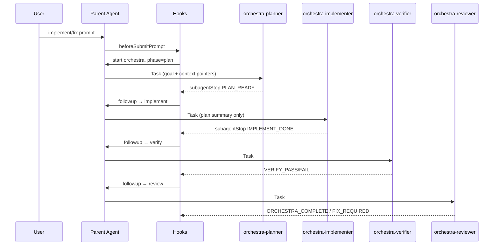

# Agent Harness Recommendations — Cursor, OpenCode & Orchestra

Research-backed guide for improving **pcore-orchestra**: full loop, harness design, prompts, token economics, and business/engineering/STEM framing.

**Related:** `context/harness-scaffold-loop.md`, `docs/token-optimization.md`, `bundle/skills/orchestra-loop/SKILL.md`

**Sources (2025–2026):** [Cursor Subagents](https://cursor.com/docs/subagents), [Cursor Agent Best Practices](https://cursor.com/blog/agent-best-practices), [OpenCode Skills](https://opencode.ai/docs/skills/), [Harness Effect (arxiv)](https://arxiv.org/html/2607.06906), MindStudio/Augment/Enhans harness engineering, agentpatterns.ai.

---

## Table of contents

1. [Business & product framing](#1-business--product-framing)
2. [STEM / engineering mental model](#2-stem--engineering-mental-model)
3. [Harness > Scaffold > Loop — what to improve](#3-harness--scaffold--loop--what-to-improve)
4. [Full orchestra loop (Cursor)](#4-full-orchestra-loop-cursor)
5. [OpenCode parity & differences](#5-opencode-parity--differences)
6. [Agent prompt recommendations](#6-agent-prompt-recommendations)
7. [Harness bloat audit](#7-harness-bloat-audit)
8. [Token & cost economics](#8-token--cost-economics)
9. [Prioritized roadmap for pcore-orchestra](#9-prioritized-roadmap-for-pcore-orchestra)
10. [References](#10-references)

---

## 1. Business & product framing

### Value proposition

| Stakeholder | Orchestra delivers |
|-------------|-------------------|
| **Individual dev** | Repeatable plan→ship without re-explaining process every session |
| **Team lead** | Enforced quality gates, git hygiene, doc sync (`progress-tracker.md`) |
| **Org / FinOps** | Bounded iterations, token tracker, phase-specific model routing |
| **Product** | Six-file context ties code changes to scope and success criteria |

### KPIs to track (already partially instrumented)

| KPI | Where | Target |
|-----|-------|--------|
| Cost per successful task | `orchestra-tokens.json` + outcome | Trend down 20% quarter |
| Cycle completion rate | `orchestra-history.json` | >85% `completed` vs `max_iterations` |
| Time to first plan | `lifecycle.phase_history` | <3 min |
| FIX_REQUIRED loops per cycle | `orchestra.json` iteration | ≤1 average |
| Doc sync compliance | reviewer gate | 100% on shipped work |

### When to use which route

| Route | Business case | Technical trigger |
|-------|---------------|-------------------|
| **Core** (default) | Feature/fix in one repo, clear scope | implement verbs, no architecture migration |
| **Enterprise** | Multi-team SDLC, compliance, release train | `/enterprise`, security audit, migration |
| **No orchestra** | Q&A, spikes, learning | explain-only, `no orchestra` |

**Recommendation:** Market core as “CI for agent work” — same phases every time, auditable state file, not ad-hoc chat.

---

## 2. STEM / engineering mental model

Treat orchestra as a **closed-loop control system**:

```text
Setpoint (goal) → Planner (feedforward) → Implementer (actuator)
                      ↑                           ↓
                 Reviewer (supervisor) ← Verifier (sensor)
                      ↓
                 FIX_REQUIRED → negative feedback → Implementer
```

| Control concept | Orchestra mapping |
|-----------------|-------------------|
| **Setpoint** | `orchestra.json` goal |
| **Plant** | Target repo + toolchain |
| **Sensors** | Verifier (tests, lint, git clean) |
| **Controller** | Hooks (`subagentStop`, phase-engine) |
| **Actuator** | Implementer (only writer + committer) |
| **Saturation** | `max_iterations`, stall abort |
| **State observer** | Token tracker, lifecycle events, memory |

**STEM practices to adopt:**

1. **Measure before optimize** — token tracker, history, phase durations (done V3.3.5).
2. **Separate concerns** — harness (hooks) vs scaffold (agents) vs loop (phase chain).
3. **Fail-safe defaults** — ambient ON but opt-out; max iterations; stall detection.
4. **Reproducibility** — versioned install bundle, health check, six-file templates.
5. **Documentation as spec** — planner output is the experiment protocol; verifier is the test bench.

---

## 3. Harness > Scaffold > Loop — what to improve

### Harness (runtime — `bundle/hooks/`)

**Current strengths:** Config-driven phase engine, state V3, crash recovery, token tracker, quality gates, heartbeat.

| Recommendation | Why | Effort |
|----------------|-----|--------|
| **Cache-shaped prompt injection** | Static blocks first (ambient policy, six-file order), dynamic last — improves provider prompt cache hit rate | Medium |
| **Subagent handoff schema** | Parent passes `{ goal, plan_bullets, files, prior_failures }` not full transcript | Low (doc + rule) |
| **Per-phase model hints in followup_message** | “Use fast model for planner” in hook text where Cursor supports it | Low |
| **Compaction hook** (optional) | Prune tool output from parent context between phases | High |
| **Harness metrics export** | Prometheus-style counters from `orchestra-metrics.json` | Medium |
| **Semantic memory (BM25-lite)** | ✅ V3.5.0 — `semantic-memory.js`, `memory recall` CLI | Done |
| **Structured plan artifact** | Persist planner output between phases | High |
| **SQLite FTS memory** | Scale episodic memory with BM25 | Medium |

See also: **`docs/agent-orchestra-rag-research.md`** — RAG tiers, context engineering, gaps vs 2026 harness practice.

**Anti-patterns to avoid:**

- Duplicating agent instructions inside hook `additional_context` (bloat).
- Parent agent doing implementer work between phases (breaks isolation).
- Unbounded `followup_message` loops without `loop_limit` in `hooks.json`.

### Scaffold (behavior — agents, skills, rules, context)

**Current strengths:** 4 focused core agents, enterprise SDLC library, orchestra-loop skill, six-file injection.

| Recommendation | Why | Effort |
|----------------|-----|--------|
| **Split agent identity vs workflow** | Move personality blocks to `references/identity.md`; keep agent body <80 lines | Medium |
| **Progressive skill loading** | Skills advertise via description only; full SKILL.md on demand (OpenCode pattern) | Done for OpenCode; mirror in Cursor docs |
| **Rules vs skills split** | `orchestra-loop.mdc` = always-on policy; `orchestra-loop` skill = deep reference | Done — keep rules under 60 lines |
| **Phase-specific tool policy in agents** | Explicit “no web” on planner/reviewer (already in token section) | Done V3.3.4 |
| **Structured end markers** | `PLAN_READY`, `VERIFY_PASS`, etc. — machine-parseable for future automation | Done |

### Loop (execution cycle — phase chain)

**Current strengths:** plan→implement→verify→review, FIX_REQUIRED loop, enterprise 32-phase opt-in.

| Recommendation | Why | Effort |
|----------------|-----|--------|
| **Explicit “definition of done” per phase** | Reduces reviewer↔implementer ping-pong | Low (agent text) |
| **Parallel read-only research** | Planner spawns parallel grep/read (Cursor subagent pattern) — not parallel writes | Medium |
| **Optional TDD micro-loop** | Verifier fail → implementer with single failing test id | Low |
| **Enterprise phase pruning** | Project template picks subset of SDLC phases, not all 32 | Medium |

---

## 4. Full orchestra loop (Cursor)

### Canonical flow (core)



### Parent agent rules (from Cursor docs + orchestra)

1. **Tech lead, not sole implementer** — delegate all four phases via Task with exact subagent names.
2. **Structured handoffs** — pass concise summaries; subagent output stays in subagent context.
3. **No parallel writes** — sequential phases; use worktrees only for explicitly parallel features.
4. **Guardrails** — `max_iterations: 8`, stall at 5 min, stop hook nudge cap 3.
5. **One goal** — `orchestra-enable.js stop` before unrelated work.

### Hook stack (keep thin)

| Hook | Role | Must stay fast |
|------|------|----------------|
| `sessionStart` | Ambient policy + six-file + token trends | Yes |
| `beforeSubmitPrompt` | Classify + auto-start | Yes (5s timeout) |
| `subagentStop` | Phase chain + token record | Yes |
| `subagentStop` | lifecycle, memory, quality-gate | Parallel OK |
| `stop` | Stall + parent nudge | loop_limit 5 |

### Full loop checklist (for operators)

- [ ] `install.ps1` / `install.sh` run after bundle changes
- [ ] Cursor restarted; hooks visible in Settings
- [ ] `node orchestra-health.js` passes
- [ ] Target project has `context/` or accept generic planning
- [ ] Parent uses `orchestra-*` Task names, not `generalPurpose`
- [ ] After cycle: `orchestra-enable.js tokens` + update `progress-tracker.md`

---

## 5. OpenCode parity & differences

| Capability | Cursor | OpenCode | Orchestra action |
|------------|--------|----------|------------------|
| Phase chaining | Hooks `subagentStop` | Skill + manual Task | Hooks primary; skill documents both |
| Subagents | `.cursor/agents/*.md` | `.config/opencode/agents/*.md` | `sync-opencode-agents.js` |
| Always-on rules | `.mdc` rules | N/A | `orchestra-loop.mdc` |
| Skills | `.cursor/skills/` | `.config/opencode/skills/` + `skill` tool | Mirrored bundle |
| Permissions | `permissions.json` + Auto-review / CLI unrestricted | `opencode.json` `permission` + `--auto` | See `docs/autonomous-workflow.md`; `setup-opencode-optimal.sh` |
| Token prune | Manual | `compaction.prune` | Recommend balanced profile |
| Step limits | Hook iterations | `agent.*.steps` | Align steps with max_iterations |

### OpenCode-specific recommendations

1. **Generate `opencode.json` example in repo** — balanced profile, per-agent steps, web deny on read-only phases; `bash: allow` on readonly agents (see `docs/autonomous-workflow.md`).
2. **Skill permissions** — `permission.skill`: allow `orchestra-loop`, `verification-before-completion`, UI skills; deny unused Cloudflare skills on planner.
3. **Progressive disclosure** — keep SKILL.md bodies <500 lines; move Cloudflare refs to `references/` (already pattern in bundle).
4. **External discovery** — keep `~/.agents/skills/orchestra-loop` symlink (install scripts do this).
5. **Session autonomy** — run `opencode --auto` (or TUI auto-approve) so remaining `ask` rules do not stall loops; denies still apply.

```json
{
  "compaction": { "auto": true, "prune": true, "reserved": 8000 },
  "agent": {
    "orchestra-planner": {
      "steps": 8,
      "permission": { "edit": "deny", "websearch": "deny" }
    },
    "orchestra-implementer": { "steps": 25 },
    "orchestra-verifier": {
      "steps": 10,
      "permission": { "edit": "deny", "bash": "allow" }
    },
    "orchestra-reviewer": {
      "steps": 5,
      "permission": { "edit": "deny", "websearch": "deny", "webfetch": "deny" }
    }
  }
}
```

Run: `bash scripts/setup-opencode-optimal.sh --balanced`

---

## 6. Agent prompt recommendations

### Design principles (Cursor + Anthropic + OpenCode)

| Principle | Application |
|-----------|-------------|
| **One job per agent** | Planner plans only; implementer commits only |
| **Description = routing signal** | Frontmatter `description` must say *when* to invoke |
| **Concise body** | Target <100 lines workflow; identity optional/split |
| **Structured output** | Markdown sections + terminal marker line |
| **Readonly enforcement** | Cursor: `readonly: true`; OpenCode: `permission.edit: deny` |
| **Token section** | Per-phase budget rules (V3.3.4) |

### Per-phase prompt template (parent → subagent)

```markdown
## Goal
[one sentence from orchestra.json]

## Plan summary (implementer+ only)
[3–5 bullets from planner — not full transcript]

## Context pointers
- Read: context/progress-tracker.md, context/architecture.md (if present)
- Do NOT re-read files already listed unless plan requires

## Prior failures (if FIX_REQUIRED loop)
1. file:line — fix description

## End marker
Output must end with: PLAN_READY | IMPLEMENT_DONE | VERIFY_PASS | VERIFY_FAIL | ORCHESTRA_COMPLETE | FIX_REQUIRED
```

### Description field examples (good vs bad)

| Bad | Good |
|-----|------|
| "Helps with coding tasks" | "Orchestra phase 1 — research codebase and produce short plan. Auto-invoked on fix/build/refactor." |
| "General assistant" | "Orchestra phase 3 — run tests/lint; read-only; ends with VERIFY_PASS or VERIFY_FAIL" |

### Enterprise agents (32 SDLC)

- **Keep for `/enterprise` only** — do not inject all 32 into ambient context.
- **Slim further** — identity one-liners in `references/` (progress-tracker next up).
- **Category folders** — already aligned with business functions (01-idea … 10-review).

---

## 7. Harness bloat audit

Run quarterly (or when context feels slow):

| Layer | Audit question | Action if yes |
|-------|----------------|---------------|
| Rules | >60 lines in always-on `.mdc`? | Move detail to skill |
| Skills | >50 skills enabled globally? | Project-scope MCP/skills |
| Agents | Personality >30% of file? | Split to references |
| Hooks | Duplicate instructions in `additional_context`? | Deduplicate |
| MCP | Tool schemas >15k tokens? | Dynamic tool loading |
| Memory | Stale goals in injection? | Cap + summarize |
| Six-file | Full files pasted vs read order? | Read order only (current) |

**Cursor docs:** Start with 2–3 subagents; add only on recurring failure patterns — orchestra core 4 is the sweet spot.

---

## 8. Token & cost economics

See `docs/token-optimization.md` for full detail. Harness-level summary:

| Technique | Orchestra status |
|-----------|------------------|
| Phase isolation (subagent context) | ✅ Built-in |
| Token tracker + tips | ✅ V3.3.5 |
| Per-agent budgets in prompts | ✅ V3.3.4 |
| Model routing (OpenCode) | ✅ setup-opencode-optimal.sh |
| Prompt caching (static prefix) | ⚠️ Recommended — structure injections |
| Parent concise handoffs | ⚠️ Documented — enforce via rules |
| Parallel tool batching | ⚠️ Agent guidance only |
| External state (orchestra.json) | ✅ |

**Research note (Harness Effect):** Multi-agent can be ~15× chat tokens; orchestra’s sequential 4-phase design is intentionally **not** shared-transcript multi-agent — it caps multiplier vs CrewAI-style conversation sharing.

---

## 9. Prioritized roadmap for pcore-orchestra

### P0 — Do now (high ROI, low effort)

1. ✅ Token tracker + `orchestra-enable.js tokens`
2. ✅ Token efficiency sections in core agents
3. ✅ `docs/token-optimization.md`
4. **Restart Cursor after install** — operators must reload hooks
5. **Parent handoff template** — add to `orchestra-loop.mdc` (3 lines)

### P1 — Next sprint

1. **`docs/opencode.json.example`** — committed balanced profile
2. **Agent identity split** — `references/identity.md` per core agent
3. **Cache-shaped sessionStart** — reorder `additional_context`: static → dynamic
4. **Harness metrics dashboard** — extend `orchestra-enable.js metrics` CLI

### P2 — Medium term

1. **Project phase profiles** — `project.yaml` field: `orchestra.route`, `orchestra.max_iterations`
2. **Optional plan-only mode** — ambient starts planner, user confirms before implement
3. **Evidence gate automation** — wire `evidence-runner.js` output into verifier prompt
4. **Enterprise phase picker** — template YAML listing enabled SDLC phases

### P3 — Research / optional

1. **Model tier per phase** — Cursor when API exposes per-Task model
2. ~~**Semantic memory** — embed past goals for planner retrieval~~ ✅ BM25-lite V3.5.0; hybrid embeddings P4
3. **Structured plan artifact** — `.cursor/orchestra-plan.md` between phases
4. **Worktree orchestration** — parallel implementers for monorepo packages
5. **STEM edu mode** — export cycle as “lab report” (hypothesis, method, results)

---

## 10. References

| Resource | Topic |
|----------|-------|
| [Cursor Subagents](https://cursor.com/docs/subagents) | Isolation, descriptions, anti-patterns |
| [Cursor Agent Best Practices](https://cursor.com/blog/agent-best-practices) | Rules vs skills, hook loops |
| [OpenCode Skills](https://opencode.ai/docs/skills/) | Progressive loading, permissions |
| [Harness Effect (arxiv 2607.06906)](https://arxiv.org/html/2607.06906) | Token economics of orchestration |
| [Augment — Harness Engineering](https://www.augmentcode.com/guides/harness-engineering-ai-coding-agents) | Phase gates, context resets |
| [MindStudio — Harness Engineering](https://www.mindstudio.ai/blog/what-is-harness-engineering-ai-coding) | Task graphs, validation |
| `docs/token-optimization.md` | Tool calls, web search, tracker |
| `context/harness-scaffold-loop.md` | Three-layer architecture |
| `docs/02-FEATURES-HOOKS-COMPONENTS-AGENTS.md` | Hook I/O, agent budgets |

---

*Last updated: 2026-07-22 — Orchestra V3.3.5*
