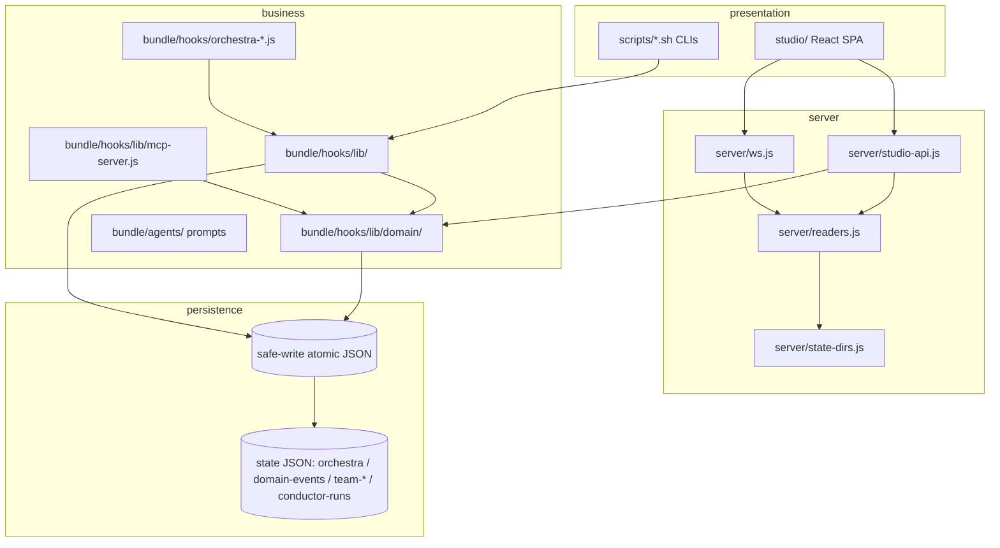

# Layer Diagram

Layered view of pcore-orchestra (Mark Richards style: closed layers, downward-only
imports). `context/architecture.md` links here instead of repeating layer prose.

## Mermaid layer graph

Closed layers: every call crosses one layer down. No upward or skip-level imports
(see table below).

## Per-subsystem pattern (Mark Richards)

| Subsystem | Pattern | Layers used |
|-----------|---------|-------------|
| Studio dashboard | Closed layered | SPA → `server/*` HTTP → readers → state JSON (invariants 35/36) |
| Hook pipeline | Closed layered | `orchestra-*.js` entry → `lib/*` → safe-write store (invariants 15/19) |
| Domain model | Layered, sole-writer persistence | `domain/*` → `store.js` only writer of `domain-*.json` (invariant 19) |
| Team pairing (claims/discussion/wakes) | Layered with shared-state carve-out | lib → shared team dir, worktree-partitioned rest (invariants 30/31) |
| MCP / knowledge server | Read-only layered facade | transports → `McpServer` → readers/store reads, never direct edits (invariant 34) |
| Agent scaffold | Layered prompts, no imports | conductor → phase agents → lib (no code imports upward) |

## Trade-offs

- Isolation vs ceremony: closed layers make invariants 15/19 enforceable in one
  place (`safe-write.js` / `domain/store.js`), at the cost of indirection for
  trivial reads (accepted — readers stay the single read path).
- Sinkhole guard: pass-through layers with no logic are a smell (Richards'
  architecture sinkhole); each layer here owns a rule (server: loopback bind +
  read-only; business: gates + evidence; persistence: atomicity + ring caps).
- JSON-file persistence: zero-dep and inspectable, but concurrency needs advisory
  locks and worktree partitioning (invariants 15/30/31) instead of transactions.

## Allowed-import table

| From → To | Rule |
|-----------|------|
| presentation → server (HTTP/`server/*`) | ✅ only path |
| presentation → `bundle/hooks/lib`, state files | ❌ never (ex-`stateResolver.ts` deleted: Node `fs` can't run in browser) |
| server → `server/readers.js`, state-dirs | ✅ read path |
| server → state files (writes) | ❌ never; single write path is `PATCH` → `store.appendEvent` (invariant 36) |
| business lib → safe-write / `domain/store.js` | ✅ write path (invariants 15/19) |
| business lib → `server/`, `studio/` | ❌ never (upward import) |
| persistence (JSON) → anything | ❌ data only, no imports |

## Violation examples

1. `studio/src/lib/stateResolver.ts` imported Node `fs`/`child_process` and read
   state dirs from the browser — deleted; `server/state-dirs.js` is the sole
   discovery owner, exposed via `GET /api/state-dirs` (invariant 35).
2. A `server/` handler writing a hook state file directly instead of
   `store.appendEvent` — bypasses the sole writer (invariant 19) and breaks
   worktree partitioning (invariant 31).
3. A hook lib module importing from `server/` or `studio/` — upward import;
   platform logic stays in `spawn-adapter.js`, reads in `readers.js`.
4. Raw `fs.writeFile` on shared state instead of `atomicWrite`/`updateState` —
   breaks atomicity (invariant 15); corrupt files must quarantine, never reset.
